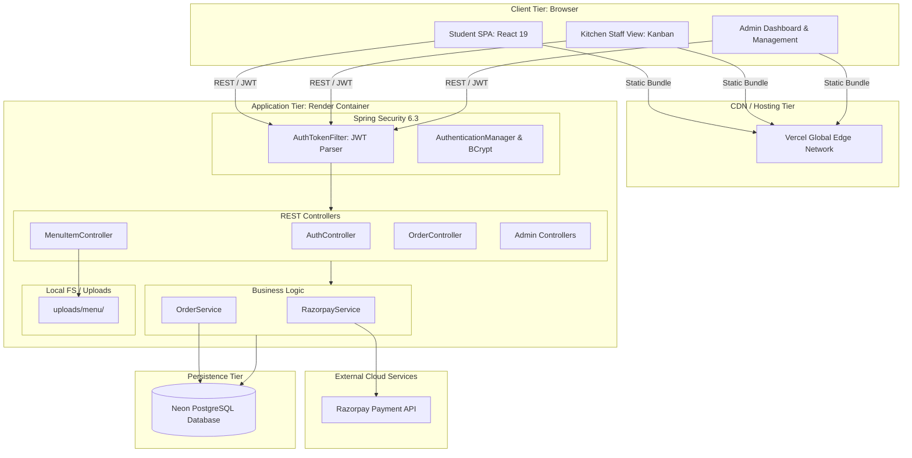
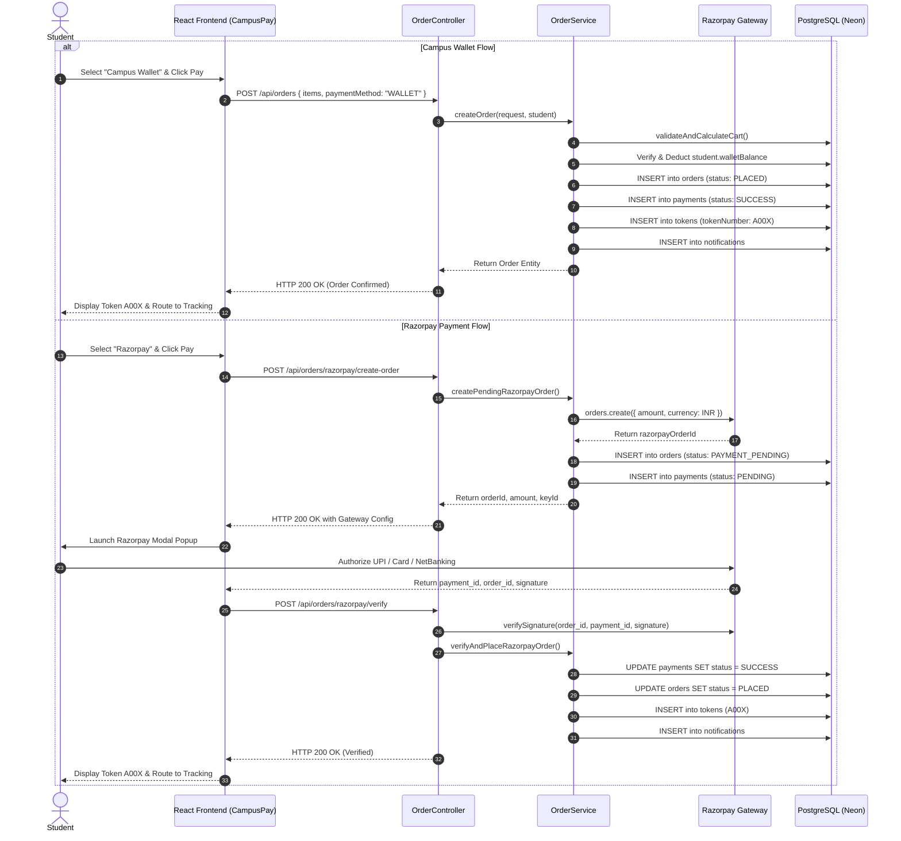

# BunkBites: Comprehensive Technical Project Audit & Master Reference Specification

**Document Version:** 1.0.0  
**Project Name:** BunkBites (Smart Campus Canteen Management System)  
**Project Root Directory:** `C:\smart-campus-canteen`  
**Repository:** [https://github.com/akashenguva30-cpu/BunkBites](https://github.com/akashenguva30-cpu/BunkBites)  
**Target Environment:** Academic viva voce, project reports, technical defense, and architectural documentation  
**Audit Date:** October 2026  
**Auditor Verification Level:** Direct Codebase Static & Dynamic Inspection  

---

## Executive Summary & Inspection Scope

This document provides a factual, verified, and comprehensive technical audit of the **BunkBites** web application. Every claim, endpoint, schema definition, and architectural pattern in this document has been cross-referenced against the active codebase files in `backend/` and `frontend/`. 

- **Frontend:** Single Page Application (SPA) built with React 19 and Vite 8, styled with custom Vanilla CSS design tokens.
- **Backend:** Spring Boot 3.3.4 REST API running on Java 21 with Maven, Spring Data JPA, Spring Security, JJWT (io.jsonwebtoken 0.12.5), and Razorpay SDK 1.4.6.
- **Database:** PostgreSQL (production hosted on Neon Serverless Postgres, development configured for local PostgreSQL).
- **Hosting/Deployment:** Docker containerized backend hosted on Render, SPA frontend hosted on Vercel.

---

## 1. Project Overview & Problem Statement

### 1.1 Academic Project Title
**BunkBites: An Automated Smart Campus Canteen Pre-Ordering, Digital Token Queue, and Multi-Channel Payment Management System**

### 1.2 Problem Statement
Traditional university and college campus canteens suffer from severe operational bottlenecks during peak hours (class transition intervals, lunch breaks):
1. **Prolonged Queue Latency:** Students spend 15–30 minutes waiting in physical queues just to place an order, followed by additional waiting for food preparation.
2. **Order Disorganization & Miscommunication:** Verbal orders and manual paper slips lead to lost tickets, incorrect items, and inventory disputes.
3. **Cash & Change Congestion:** Handling physical cash during short break windows slows cashier throughput and introduces accounting discrepancies.
4. **Lack of Preparation Transparency:** Students have no visibility into queue depth, preparation times, or whether an item is sold out before waiting in line.
5. **Kitchen Inefficiency:** Kitchen staff cannot forecast prep workload, prioritize batches, or notify students reliably when orders are ready.

### 1.3 Project Objectives
- Provide a responsive web interface allowing students to view live menu availability, browse categories, and place pre-orders from anywhere on campus.
- Implement an automated digital order token system (e.g., `A001`, `A002`) tied to a live queue tracking engine that calculates orders ahead.
- Provide dual payment options: a simulated/instant campus wallet balance (`Campus Wallet`) and real-world payment gateway integration (`Razorpay`).
- Deliver a dedicated operational Kanban dashboard for kitchen staff to transition orders through strict lifecycle states (`PLACED` → `ACCEPTED` → `PREPARING` → `READY` → `COLLECTED`).
- Provide administrative control over menu items, real-time availability toggling, category management, automated refund handling, user account management, and daily revenue reporting.

### 1.4 Intended User Personas
1. **Student (`ROLE_STUDENT`):**
   - Discovers available food items categorized with price, preparation time, and star ratings.
   - Saves favorite items, adds items to cart, selects payment mode, and tracks real-time progress.
   - Collects food using an alphanumeric token number and submits 1–5 star reviews upon order completion.
2. **Kitchen Staff (`ROLE_STAFF`):**
   - Views incoming orders in a real-time Kanban layout (New, Preparing, Ready).
   - Accepts or rejects orders; updates status as cooking progresses.
   - Rapidly toggles item availability (in-stock vs. sold-out) based on kitchen inventory.
3. **Canteen Administrator (`ROLE_ADMIN`):**
   - Monitors live campus canteen metrics: revenue today, active orders, completed orders, cancelled orders, and popular items.
   - Manages menu items (with image uploads) and category taxonomy.
   - Inspects the full order and payment ledger with status/search filters.
   - Provisions kitchen staff accounts and controls user activation statuses.

### 1.5 Proposed Solution Architecture
BunkBites replaces physical canteen counters with a decoupled client-server architecture:
- A modern clientside React SPA communicating over REST to a stateless Spring Boot microservice.
- Synchronous and asynchronous order processing: orders generate unique tokens, immutable status audit logs (`OrderStatusHistory`), and in-app notifications.
- Integrated dual-mode payment gateway: native campus wallet with balance verification plus Razorpay cryptographic HMAC-SHA256 signature verification.

---

## 2. Implemented Features by Role (Code-Verified)

Every feature listed below is verified against concrete source code implementations in `backend/src/main/java/com/campus/canteen/` and `frontend/src/`:

### 2.1 Student Features (`ROLE_STUDENT`)
| Feature | Code Implementation File(s) | Verification Details |
| :--- | :--- | :--- |
| **Self-Registration & Authentication** | `AuthController.java`, `Register.jsx`, `Login.jsx` | User registers with username, email, password; receives default `ROLE_STUDENT` and ₹500 default wallet balance. |
| **Menu Browsing & Availability Filtering** | `MenuItemController.java`, `StudentMenu.jsx` | Browses all available items (`/api/menu/available`). Unavailable items are excluded or badged as "SOLD OUT". |
| **Category & Search Filtering** | `MenuItemController.java`, `StudentMenu.jsx` | Dynamic filtering by category ID and case-insensitive keyword search. |
| **Campus Smart Discovery Sections** | `StudentMenu.jsx`, `slogans.js`, `sloganEngine.js` | Curated horizontal scrolling feeds: *Your Favourites*, *Popular on Campus* (last 30 days query), *Quick Bites (<10 mins)*, *Budget Friendly (<₹100)*, plus randomized campus slogan banners. |
| **Favorites Management** | `FavoriteController.java`, `StudentFavorites.jsx` | Toggle favorite state via heart icon (`POST`/`DELETE` `/api/favorites/{menuItemId}`). Dedicated favorites page. |
| **Cart & Order Checkout Modal** | `CampusPay.jsx`, `StudentMenu.jsx` | Item quantities increment/decrement; multi-step modal calculating subtotal and grand total. |
| **Dual Payment: Campus Wallet** | `OrderService.java`, `CampusPay.jsx` | Deducts from `user.walletBalance`. Validates balance; throws `PaymentFailedException` if insufficient. |
| **Dual Payment: Razorpay Gateway** | `RazorpayService.java`, `OrderController.java`, `CampusPay.jsx` | Server generates pending order and Razorpay order ID; client loads `checkout.js`; server verifies HMAC-SHA256 signature upon completion. |
| **Alphanumeric Token Generation** | `OrderService.java`, `Token.java` | Orders receive a unique sequence-formatted token string (e.g., `A001`). |
| **Live Queue Tracking & Estimation** | `OrderController.java`, `StudentOrderDetails.jsx` | Endpoint `/api/orders/{id}/queue` calculates number of orders placed earlier in the day that are still active (`PLACED`, `ACCEPTED`, `PREPARING`). |
| **Visual Order Timeline** | `StudentOrderDetails.jsx` | Step-by-step progress tracker reflecting real timestamps from `OrderStatusHistory`. |
| **Order Cancellation** | `OrderService.java`, `OrderController.java`, `OrderHistory.jsx` | Students can cancel orders while in `PLACED` status. Automatically refunds wallet payments. |
| **Order History (Active & Past)** | `OrderHistory.jsx`, `OrderController.java` | Tabbed view separating ongoing active orders from historical collected/cancelled/rejected orders. |
| **In-App Notification Feed** | `NotificationController.java`, `StudentNotifications.jsx` | Real-time order update messages with visual categorization (green for ready, orange for prep, red for cancel/reject); mark as read and mark all as read. |
| **Post-Collection Order Rating** | `FeedbackController.java`, `OrderRating.jsx` | 1–5 star rating with optional 500-char comment, permitted only when order status is `COLLECTED`. |
| **Profile & Password Management** | `ProfileController.java`, `Profile.jsx` | Update email address and change password with BCrypt verification. |

### 2.2 Kitchen Staff Features (`ROLE_STAFF`)
| Feature | Code Implementation File(s) | Verification Details |
| :--- | :--- | :--- |
| **Staff Authentication** | `AuthController.java`, `Login.jsx` | Logs in with staff credentials; automatically routed to `/staff/orders`. |
| **Kitchen Kanban Board** | `StaffOrders.jsx`, `OrderController.java` | Real-time Kanban columns: *New Orders* (`PLACED`/`ACCEPTED`), *Preparing* (`PREPARING`), and *Ready* (`READY`). |
| **State Transitions** | `OrderService.java`, `StaffOrders.jsx` | Strict state transition buttons: Accept Order (`ACCEPTED`), Reject Order (`REJECTED`), Start Preparing (`PREPARING`), Mark Ready (`READY`), Mark Collected (`COLLECTED`). |
| **Automatic Refund on Rejection** | `OrderService.java` | If staff rejects an order, payment status becomes `REFUNDED` and student wallet balance is credited back immediately. |
| **Quick Inventory Availability Toggle** | `StaffOrders.jsx`, `MenuItemController.java` | Kitchen staff can toggle item availability on/off directly from kitchen operations without opening admin settings. |
| **Kitchen Order Ledger Filter** | `StaffOrders.jsx` | History drawer with filters for `ALL`, `COLLECTED`, `CANCELLED`, and `REJECTED`. |
| **Category and Menu Item Viewing** | `CategoryController.java`, `MenuItemController.java` | Staff can view all menu and category configurations. |

### 2.3 Administrator Features (`ROLE_ADMIN`)
| Feature | Code Implementation File(s) | Verification Details |
| :--- | :--- | :--- |
| **Executive Canteen Dashboard** | `AdminController.java`, `AdminDashboard.jsx` | Aggregates daily operational metrics: Total Orders Today, Active Orders, Completed Orders, Cancelled Orders, Revenue Today, Top 5 Popular Items, and 10 Recent Orders. |
| **Menu Item CRUD & Image Upload** | `MenuItemController.java`, `AdminMenu.jsx` | Create, update, and delete menu items. Uploads JPEG/PNG/WEBP images via multipart form data (`/api/menu/upload-image`). |
| **Category CRUD** | `CategoryController.java`, `AdminMenu.jsx` | Create, update, and delete menu categories with uniqueness checks on category names. |
| **Master Order Ledger** | `AdminOrderController.java`, `AdminOrders.jsx` | Searchable table of all campus orders with status filter, student username, token number, items, and total amount. |
| **Master Payment Ledger** | `AdminPaymentController.java`, `AdminPayments.jsx` | Filter transactions by payment status (`SUCCESS`, `PENDING`, `FAILED`, `REFUNDED`) and payment method. Calculates daily revenue, refund totals, and failure counts. |
| **User & Staff Account Administration** | `AdminUserController.java`, `AdminUsers.jsx` | Lists all users with role filtering; creates new staff accounts (`POST /api/admin/users/staff`); enables/disables user accounts (with self-disable protection). |
| **Kitchen View Access** | `AdminSidebar.jsx` | Admins have full access to the operational kitchen view (`/staff/orders`). |

---

## 3. Frontend Architecture

### 3.1 Technology Foundation
- **Framework:** React 19 (`react: ^19.2.8`, `react-dom: ^19.3.0`)
- **Build Tool:** Vite 8 (`vite: ^8.3.0`, `@vitejs/plugin-react: ^6.1.1`)
- **Routing:** React Router DOM v7 (`react-router-dom: ^7.18.4`)
- **HTTP Client:** Axios (`axios: ^1.20.0`)
- **Linter:** Oxlint (`oxlint: ^1.81.0`)
- **Styling Architecture:** Pure Vanilla CSS with CSS custom properties (variables) defined in `src/index.css`. No TailwindCSS or third-party UI component libraries are used.

### 3.2 Design System Tokens (`src/index.css`)
```css
:root {
  --bg-color: #FCFAF7;
  --surface-color: #FFFFFF;
  --primary-color: #E94F37;       /* Warm Terracotta / Red */
  --primary-hover: #D03D27;
  --text-primary: #171717;
  --text-secondary: #77736F;
  --border-color: #EAE6E1;
  --success-color: #2E8B57;
  --error-color: #C62828;
  --warning-color: #F57C00;
  --font-family: 'Inter', sans-serif;
  --radius-sm: 8px;
  --radius-md: 12px;
  --radius-lg: 16px;
  --shadow-sm: 0 2px 4px rgba(0,0,0,0.05);
  --shadow-md: 0 4px 12px rgba(0,0,0,0.08);
}
```

### 3.3 Application Routing & Protected Routes (`src/App.jsx`)
Client-side routing uses `BrowserRouter`, `Routes`, `Route`, and a custom `ProtectedRoute` wrapper component:
```jsx
const ProtectedRoute = ({ children, allowedRoles }) => {
  const token = sessionStorage.getItem('token');
  const role = sessionStorage.getItem('role');

  if (!token) return <Navigate to="/" />;
  if (allowedRoles && !allowedRoles.includes(role)) return <Navigate to="/" />;
  
  return children;
};
```

#### Complete Route Map:
| URL Route | Component | Allowed Role(s) | Description |
| :--- | :--- | :--- | :--- |
| `/` | `Login.jsx` | Public | Authentication entry point (Username & Password) |
| `/register` | `Register.jsx` | Public | Student account registration |
| `/student` | `StudentMenu.jsx` | `ROLE_STUDENT` | Main menu discovery, search, cart, and order placement |
| `/favorites` | `StudentFavorites.jsx` | `ROLE_STUDENT` | Student's saved favorite food items |
| `/orders` | `OrderHistory.jsx` | `ROLE_STUDENT` | Active & past orders list with cancel action |
| `/orders/:id` | `StudentOrderDetails.jsx` | `ROLE_STUDENT` | Order tracking, queue position, timeline, review form |
| `/notifications` | `StudentNotifications.jsx`| `ROLE_STUDENT` | Chronological updates feed (Today, Yesterday, Older) |
| `/profile` | `Profile.jsx` | `ROLE_STUDENT`, `ROLE_STAFF`, `ROLE_ADMIN` | Personal details and password change |
| `/staff/orders` | `StaffOrders.jsx` | `ROLE_STAFF`, `ROLE_ADMIN` | Kitchen operational Kanban board and item availability toggling |
| `/admin` | `AdminMenu.jsx` | `ROLE_STAFF`, `ROLE_ADMIN` | Menu item CRUD and category taxonomy management |
| `/admin/dashboard` | `AdminDashboard.jsx` | `ROLE_ADMIN` | Canteen revenue analytics and daily order stats |
| `/admin/orders` | `AdminOrders.jsx` | `ROLE_ADMIN` | Master order ledger with filters |
| `/admin/payments` | `AdminPayments.jsx` | `ROLE_ADMIN` | Master payment ledger and revenue metrics |
| `/admin/users` | `AdminUsers.jsx` | `ROLE_ADMIN` | User accounts, staff creation, and status toggling |

### 3.4 API Configuration & Interceptor (`src/api/axiosConfig.js`)
- **Base URL:** Driven by `import.meta.env.VITE_API_URL` with fallback to `http://localhost:8080/api`.
- **Request Interceptor:** Automatically reads `token` from `sessionStorage` and attaches header:
  `Authorization: Bearer <token>`
- **Asset Resolution (`src/utils/imageUtils.js`):** Extracts origin from `VITE_API_URL` to prefix relative upload paths (e.g., `/uploads/menu/xyz.jpg` → `http://localhost:8080/uploads/menu/xyz.jpg`).

---

## 4. Backend Architecture

### 4.1 Layered Architecture Pattern
The backend adheres to the classic Spring Boot 4-tier layered architecture:
```
[ Controllers (REST Endpoints & DTO Binding) ]
                      │
[ Services (Business Rules, Transactions, Integrations) ]
                      │
[ Repositories (Spring Data JPA / Hibernate ORM) ]
                      │
[ Relational Database (PostgreSQL) ]
```

### 4.2 Security Architecture (`com.campus.canteen.security`)
- **Stateless Session Management:** Configured via `SessionCreationPolicy.STATELESS` in `WebSecurityConfig.java`. No HTTP sessions are stored on the server.
- **JWT Provider (`JwtUtils.java`):**
  - Generates tokens using `io.jsonwebtoken` (JJWT 0.12.5).
  - Claims: `subject` set to username; `issuedAt` and `expiration` set based on `canteen.app.jwtExpirationMs` (default: 86,400,000 ms = 24 hours).
  - Signed with HMAC-SHA256 using Base64-decoded secret (`canteen.app.jwtSecret`).
- **Authentication Filter (`AuthTokenFilter.java`):**
  - Extends `OncePerRequestFilter`.
  - Extracts `Bearer ` token from `Authorization` header.
  - Validates token against secret; loads `UserDetails` through `UserDetailsServiceImpl`.
  - Injects `UsernamePasswordAuthenticationToken` into `SecurityContextHolder`.
- **Method Security:** `@EnableMethodSecurity` allows declarative role gating directly on controller methods (`@PreAuthorize("hasRole('ADMIN')")`).
- **Password Hashing:** `BCryptPasswordEncoder` configured as Spring `@Bean`.
- **CORS Configuration:** Global CORS source configured to allow all origins (`*`) and methods (`GET`, `POST`, `PUT`, `DELETE`, `OPTIONS`).

### 4.3 Database Seeding & Startup Runners
Two `CommandLineRunner` beans execute automatically during application initialization:
1. `RoleSeeder` (`@Order(1)`): Ensures `ROLE_STUDENT`, `ROLE_STAFF`, and `ROLE_ADMIN` records exist in the `roles` table.
2. `UserSeeder` (`@Order(2)`): Creates default administrator and kitchen staff accounts if not already present:
   - Default Admin: username `admin`, email `admin@canteen.com`, role `ROLE_ADMIN`.
   - Default Staff: username `staff`, email `staff@canteen.com`, role `ROLE_STAFF`.

### 4.4 Data Transfer Objects (DTOs)
| DTO Class | Purpose | Key Fields |
| :--- | :--- | :--- |
| `LoginRequest` | Authentication input | `username`, `password` |
| `SignupRequest` | Registration input | `username`, `email`, `password` |
| `JwtResponse` | Auth success response | `token`, `id`, `username`, `email`, `role`, `type="Bearer"` |
| `MessageResponse` | Generic status response | `message` |
| `CategoryRequest` | Create/edit category | `name`, `description` |
| `MenuItemRequest` | Create/edit food item | `categoryId`, `name`, `description`, `price`, `imageUrl`, `available`, `preparationTime` |
| `OrderRequest` | Order placement payload | `items` (List of `OrderItemRequest`), `paymentMethod`, `paymentDetails` |
| `OrderStatusUpdateRequest` | Staff status transition | `status` (`OrderStatus`) |
| `RazorpayOrderResponse` | Gateway initialization | `razorpayOrderId`, `amount`, `currency`, `keyId` |
| `RazorpayVerificationRequest` | Payment signature input | `razorpayOrderId`, `razorpayPaymentId`, `razorpaySignature` |
| `AdminDashboardDTO` | Analytics snapshot | `totalOrdersToday`, `activeOrdersToday`, `completedOrdersToday`, `cancelledOrdersToday`, `revenueToday`, `popularItems`, `recentOrders` |
| `AdminOrderDTO` | Admin order row | `id`, `studentUsername`, `totalAmount`, `status`, `tokenNumber`, `paymentMethod`, `paymentStatus`, `createdAt` |
| `AdminPaymentDTO` | Admin transaction row | `id`, `transactionReference`, `orderId`, `studentUsername`, `method`, `amount`, `status`, `createdAt` |
| `PopularItemDTO` | Popular item aggregate | `name`, `totalQuantity` |
| `FavoriteDTO` | Favorited food item | `id`, `menuItemId`, `menuItem`, `createdAt` |
| `FeedbackRequest` | Review submission | `orderId`, `rating`, `comment` |
| `FeedbackResponse` | Review detail | `id`, `orderId`, `username`, `rating`, `comment`, `createdAt` |
| `CartValidationResult` | Service validation output | `orderItems` (List), `totalAmount` (`BigDecimal`) |
| `UpdateProfileRequest` | Profile email update | `email` |
| `ChangePasswordRequest` | Password update payload | `currentPassword`, `newPassword`, `confirmPassword` |
| `UserProfileResponse` | Profile data response | `id`, `username`, `email`, `role`, `enabled` |

### 4.5 Exception Handling (`GlobalExceptionHandler.java`)
Centralized controller advice catching application exceptions:
- `MethodArgumentNotValidException`: Returns HTTP 400 with a mapped key-value dictionary of field validation error messages.
- `AccessDeniedException`: Returns HTTP 403 with body `"Access Denied"`.
- `PaymentFailedException`: Handled in `OrderController` to return HTTP 400 with `status: "FAILED"`, `message`, and `transactionReference`.
- `Exception`: Catch-all fallback returning HTTP 500 with error message string.

---

## 5. Complete REST API Specification (Source-Verified)

Every endpoint below has been verified against the respective `@RestController` source file:

| HTTP Method | API Path | Controller File | Required Role | Request Body / Params | Purpose & Behavior |
| :--- | :--- | :--- | :--- | :--- | :--- |
| **POST** | `/api/auth/login` | `AuthController.java` | Public | `LoginRequest` | Authenticates user; returns JWT token, user ID, email, and role. |
| **POST** | `/api/auth/register` | `AuthController.java` | Public | `SignupRequest` | Registers new student; assigns `ROLE_STUDENT` and initial wallet balance. |
| **GET** | `/api/auth/me` | `AuthController.java` | Authenticated | None | Returns authenticated user details including current `walletBalance`. |
| **GET** | `/api/categories` | `CategoryController.java` | Student, Staff, Admin | None | Fetches all menu categories. |
| **GET** | `/api/categories/{id}` | `CategoryController.java` | Student, Staff, Admin | Path: `id` | Fetches category by ID. |
| **POST** | `/api/categories` | `CategoryController.java` | Staff, Admin | `CategoryRequest` | Creates new category with name uniqueness validation. |
| **PUT** | `/api/categories/{id}` | `CategoryController.java` | Staff, Admin | `CategoryRequest` | Updates existing category name and description. |
| **DELETE** | `/api/categories/{id}` | `CategoryController.java` | Staff, Admin | Path: `id` | Deletes category by ID. |
| **GET** | `/api/menu` | `MenuItemController.java` | Student, Staff, Admin | `categoryId`, `search`, `all` | Returns menu items with dynamic average ratings and review counts. |
| **GET** | `/api/menu/available` | `MenuItemController.java` | Student, Staff, Admin | `categoryId`, `search` | Returns only items where `available == true`. |
| **GET** | `/api/menu/popular-ids` | `MenuItemController.java` | Student, Staff, Admin | None | Returns list of item IDs ordered by sales volume over the last 30 days. |
| **GET** | `/api/menu/{id}` | `MenuItemController.java` | Student, Staff, Admin | Path: `id` | Returns single menu item with calculated ratings. |
| **POST** | `/api/menu/upload-image`| `MenuItemController.java` | Admin | Multipart: `file` | Validates JPEG/PNG/WEBP; saves to `uploads/menu`; returns URL path. |
| **POST** | `/api/menu` | `MenuItemController.java` | Staff, Admin | `MenuItemRequest` | Creates new food item under specified category. |
| **PUT** | `/api/menu/{id}` | `MenuItemController.java` | Staff, Admin | `MenuItemRequest` | Updates existing food item details and availability flag. |
| **DELETE** | `/api/menu/{id}` | `MenuItemController.java` | Staff, Admin | Path: `id` | Deletes food item by ID. |
| **POST** | `/api/orders` | `OrderController.java` | Student | `OrderRequest` | Creates order via Wallet or simulated payment; creates token & notification. |
| **POST** | `/api/orders/razorpay/create-order` | `OrderController.java` | Student | `OrderRequest` | Validates cart; creates pending order; requests Razorpay order ID. |
| **POST** | `/api/orders/razorpay/verify` | `OrderController.java` | Student | `RazorpayVerificationRequest` | Verifies HMAC-SHA256 signature; transitions order to `PLACED`; issues token. |
| **GET** | `/api/orders` | `OrderController.java` | Student | None | Returns order history for currently logged-in student (latest first). |
| **GET** | `/api/orders/{id}` | `OrderController.java` | Student, Staff, Admin | Path: `id` | Returns order details. If student, enforces order ownership. |
| **GET** | `/api/orders/{id}/queue` | `OrderController.java` | Student | Path: `id` | Calculates live queue position: `token`, `ordersAhead`, `currentToken`, `isReady`. |
| **GET** | `/api/orders/all` | `OrderController.java` | Staff, Admin | None | Returns all orders in system sorted descending by creation timestamp. |
| **PUT** | `/api/orders/{id}/status` | `OrderController.java` | Staff, Admin | `OrderStatusUpdateRequest` | Updates order state; writes `OrderStatusHistory`; sends student notification. |
| **PUT** | `/api/orders/{id}/cancel` | `OrderController.java` | Student | Path: `id` | Cancels student's own order (only if `PLACED`); refunds wallet payment. |
| **GET** | `/api/favorites` | `FavoriteController.java` | Student | None | Lists all menu items favorited by the logged-in student. |
| **POST** | `/api/favorites/{menuItemId}` | `FavoriteController.java` | Student | Path: `menuItemId` | Adds menu item to user's favorites list. |
| **DELETE** | `/api/favorites/{menuItemId}` | `FavoriteController.java` | Student | Path: `menuItemId` | Removes menu item from user's favorites list. |
| **POST** | `/api/feedback` | `FeedbackController.java` | Student | `FeedbackRequest` | Submits 1–5 star review for a `COLLECTED` order belonging to the student. |
| **GET** | `/api/feedback/order/{orderId}` | `FeedbackController.java` | Student, Staff, Admin | Path: `orderId` | Retrieves feedback submitted for a specific order. |
| **GET** | `/api/feedback/all` | `FeedbackController.java` | Admin | None | Lists all customer reviews across all orders. |
| **GET** | `/api/notifications` | `NotificationController.java` | Student | None | Fetches in-app notifications and unread count for current student. |
| **PUT** | `/api/notifications/{id}/read` | `NotificationController.java` | Student | Path: `id` | Marks specific notification as read. |
| **PUT** | `/api/notifications/read-all` | `NotificationController.java` | Student | None | Marks all unread notifications as read. |
| **GET** | `/api/profile` | `ProfileController.java` | Student, Staff, Admin | None | Returns logged-in user profile details (ID, username, email, role, enabled). |
| **PUT** | `/api/profile` | `ProfileController.java` | Student, Staff, Admin | `UpdateProfileRequest` | Updates user email address with uniqueness validation. |
| **PUT** | `/api/profile/password` | `ProfileController.java` | Student, Staff, Admin | `ChangePasswordRequest` | Verifies current password and updates to new BCrypt hash. |
| **GET** | `/api/admin/dashboard` | `AdminController.java` | Admin | None | Computes daily metrics (orders, revenue, active, cancelled, top 5 items). |
| **GET** | `/api/admin/orders` | `AdminOrderController.java` | Admin | `status`, `search` | Filterable master order list (search by ID, student username, token). |
| **GET** | `/api/admin/orders/{id}` | `AdminOrderController.java` | Admin | Path: `id` | Fetches comprehensive order object including student and items. |
| **GET** | `/api/admin/payments` | `AdminPaymentController.java` | Admin | `status`, `method`, `search` | Filterable master transaction list. |
| **GET** | `/api/admin/payments/{id}` | `AdminPaymentController.java` | Admin | Path: `id` | Fetches transaction details by ID. |
| **GET** | `/api/admin/users` | `AdminUserController.java` | Admin | `search`, `role` | Lists users with search and role filters (`STUDENT`, `STAFF`, `ADMIN`). |
| **POST** | `/api/admin/users/staff` | `AdminUserController.java` | Admin | `Map<username, email, password>` | Creates a new kitchen staff account (`ROLE_STAFF`). |
| **PUT** | `/api/admin/users/{id}/status` | `AdminUserController.java` | Admin | `Map<enabled: boolean>` | Enables or disables a user account (prevents self-disabling). |

---

## 6. Database Schema, Entities & Relational Mapping

The database schema is managed via Spring Data JPA / Hibernate ORM (`spring.jpa.hibernate.ddl-auto=update`). Below is the exact relational mapping reflected in the Java entity models:

### 6.1 Database Entity Dictionary

```
                                  ┌───────────────┐
                                  │     roles     │
                                  └───────┬───────┘
                                          │ 1
                                          │ has
                                          │ *
┌──────────────────┐ 1         * ┌────────┴───────┐ 1         * ┌─────────────────┐
│   categories     ├─────────────┤     users      ├─────────────┤  notifications  │
└────────┬─────────┘             └────────┬───────┘             └─────────────────┘
         │ 1                              │ 1
         │ categorizes                    │ places
         │ *                              │ *
┌────────┴─────────┐ 1         * ┌────────┴───────┐ 1         1 ┌─────────────────┐
│   menu_items     ├─────────────┤     orders     ├─────────────┤    payments     │
└────────┬─────────┘             └────────┬───────┘             └─────────────────┘
         │ 1                              │ 1
         │ included in                    ├───────────────────┬───────────────────┐
         │ *                              │ 1                 │ 1                 │ 1
┌────────┴─────────┐             ┌────────┴───────┐  ┌────────┴────────┐ ┌────────┴────────┐
│   order_items    │             │     tokens     │  │ order_status_   │ │   feedback      │
└──────────────────┘             └────────────────┘  │     history     │ └─────────────────┘
                                                     └─────────────────┘
```

#### 1. `roles` (`Role.java`)
- `id` (BIGINT, Primary Key, Auto-increment)
- `name` (VARCHAR(20), Enum: `ROLE_STUDENT`, `ROLE_STAFF`, `ROLE_ADMIN`)

#### 2. `users` (`User.java`)
- `id` (BIGINT, Primary Key, Auto-increment)
- `username` (VARCHAR, NOT NULL, UNIQUE)
- `email` (VARCHAR, NOT NULL, UNIQUE)
- `password` (VARCHAR, NOT NULL, BCrypt encrypted)
- `role_id` (BIGINT, Foreign Key → `roles.id`, FetchType.EAGER)
- `wallet_balance` (NUMERIC(19, 2), NOT NULL, default `500.00`)
- `enabled` (BOOLEAN, NOT NULL, default `true`)

#### 3. `categories` (`Category.java`)
- `id` (BIGINT, Primary Key, Auto-increment)
- `name` (VARCHAR, NOT NULL, UNIQUE)
- `description` (VARCHAR)

#### 4. `menu_items` (`MenuItem.java`)
- `id` (BIGINT, Primary Key, Auto-increment)
- `category_id` (BIGINT, NOT NULL, Foreign Key → `categories.id`)
- `name` (VARCHAR, NOT NULL)
- `description` (VARCHAR)
- `price` (NUMERIC(19, 2), NOT NULL)
- `image_url` (VARCHAR)
- `available` (BOOLEAN, NOT NULL, default `true`)
- `preparation_time` (INTEGER, minutes)
- `created_at` (TIMESTAMP, Hibernate `@CreationTimestamp`)
- `updated_at` (TIMESTAMP, Hibernate `@UpdateTimestamp`)
- *Transient (Non-persisted):* `averageRating` (Double), `ratingCount` (Long)

#### 5. `orders` (`Order.java`)
- `id` (BIGINT, Primary Key, Auto-increment)
- `user_id` (BIGINT, NOT NULL, Foreign Key → `users.id`)
- `total_amount` (NUMERIC(19, 2), NOT NULL)
- `status` (VARCHAR, NOT NULL, Enum: `PAYMENT_PENDING`, `PLACED`, `ACCEPTED`, `PREPARING`, `READY`, `COLLECTED`, `CANCELLED`, `REJECTED`, default `PLACED`)
- `created_at` (TIMESTAMP, Hibernate `@CreationTimestamp`)
- `updated_at` (TIMESTAMP, Hibernate `@UpdateTimestamp`)

#### 6. `order_items` (`OrderItem.java`)
- `id` (BIGINT, Primary Key, Auto-increment)
- `order_id` (BIGINT, NOT NULL, Foreign Key → `orders.id`, Cascade ALL, Orphan Removal)
- `menu_item_id` (BIGINT, NOT NULL, Foreign Key → `menu_items.id`, FetchType.EAGER)
- `quantity` (INT, NOT NULL)
- `unit_price` (NUMERIC(19, 2), NOT NULL)
- `subtotal` (NUMERIC(19, 2), NOT NULL)

#### 7. `payments` (`Payment.java`)
- `id` (BIGINT, Primary Key, Auto-increment)
- `order_id` (BIGINT, NOT NULL, UNIQUE, Foreign Key → `orders.id`, 1-to-1)
- `amount` (NUMERIC(19, 2), NOT NULL)
- `method` (VARCHAR, NOT NULL, Enum: `UPI`, `CARD`, `CASH`, `NET_BANKING`, `WALLET`, `RAZORPAY`)
- `status` (VARCHAR, NOT NULL, Enum: `PENDING`, `SUCCESS`, `FAILED`, `REFUNDED`)
- `transaction_reference` (VARCHAR)
- `razorpay_payment_id` (VARCHAR)
- `created_at` (TIMESTAMP, Hibernate `@CreationTimestamp`)

#### 8. `tokens` (`Token.java`)
*Note: Tokens in BunkBites represent physical canteen order pickup ticket numbers, not authentication tokens.*
- `id` (BIGINT, Primary Key, Auto-increment)
- `order_id` (BIGINT, NOT NULL, UNIQUE, Foreign Key → `orders.id`, 1-to-1)
- `token_number` (VARCHAR, NOT NULL, UNIQUE, formatted as `A%03d`, e.g., `A001`)
- `token_date` (TIMESTAMP, Hibernate `@CreationTimestamp`)

#### 9. `order_status_history` (`OrderStatusHistory.java`)
- `id` (BIGINT, Primary Key, Auto-increment)
- `order_id` (BIGINT, NOT NULL, Foreign Key → `orders.id`)
- `old_status` (VARCHAR, NOT NULL, Enum `OrderStatus`)
- `new_status` (VARCHAR, NOT NULL, Enum `OrderStatus`)
- `changed_by_id` (BIGINT, NOT NULL, Foreign Key → `users.id`)
- `changed_at` (TIMESTAMP, NOT NULL, populated via `@PrePersist`)

#### 10. `feedback` (`Feedback.java`)
- `id` (BIGINT, Primary Key, Auto-increment)
- `order_id` (BIGINT, NOT NULL, UNIQUE, Foreign Key → `orders.id`)
- `user_id` (BIGINT, NOT NULL, Foreign Key → `users.id`)
- `rating` (INTEGER, NOT NULL, constrained 1 to 5)
- `comment` (VARCHAR(500))
- `created_at` (TIMESTAMP, NOT NULL, updatable = false)

#### 11. `favorites` (`Favorite.java`)
- `id` (BIGINT, Primary Key, Auto-increment)
- `user_id` (BIGINT, NOT NULL, Foreign Key → `users.id`)
- `menu_item_id` (BIGINT, NOT NULL, Foreign Key → `menu_items.id`)
- `created_at` (TIMESTAMP, NOT NULL, updatable = false)
- **Constraint:** Unique composite key on `(user_id, menu_item_id)`

#### 12. `notifications` (`Notification.java`)
- `id` (BIGINT, Primary Key, Auto-increment)
- `user_id` (BIGINT, NOT NULL, Foreign Key → `users.id`)
- `message` (VARCHAR, NOT NULL)
- `is_read` (BOOLEAN, NOT NULL, default `false`)
- `created_at` (TIMESTAMP, NOT NULL, populated via `@PrePersist`)

---

## 7. Authentication & Authorization Deep Dive

### 7.1 JWT Token Lifecycle & Anatomy
1. **Credentials Dispatch:** Client submits JSON `{ "username": "...", "password": "..." }` to `/api/auth/login`.
2. **Authentication Provider Execution:**
   - `DaoAuthenticationProvider` delegates to `UserDetailsServiceImpl`.
   - `UserDetailsServiceImpl` queries `UserRepository.findByUsername(username)`.
   - `BCryptPasswordEncoder.matches(rawPassword, encodedPassword)` compares hashes.
3. **Token Creation:**
   ```java
   public String generateJwtToken(Authentication authentication) {
       UserDetailsImpl userPrincipal = (UserDetailsImpl) authentication.getPrincipal();
       return Jwts.builder()
               .subject(userPrincipal.getUsername())
               .issuedAt(new Date())
               .expiration(new Date((new Date()).getTime() + jwtExpirationMs))
               .signWith(key())
               .compact();
   }
   ```
4. **Client-Side Storage:** React stores token in browser `sessionStorage` under key `'token'`. Role is stored in `sessionStorage` under `'role'`.
5. **Authorization Verification:** Every subsequent request includes `Authorization: Bearer <token>`. `AuthTokenFilter` validates the signature, extracts the username, rebuilds `UserDetailsImpl`, and loads authorities (`ROLE_STUDENT`, `ROLE_STAFF`, or `ROLE_ADMIN`) into Spring's `SecurityContext`.

### 7.2 Role-Based Access Control (RBAC) Matrix
| Resource URI Pattern | Public | `ROLE_STUDENT` | `ROLE_STAFF` | `ROLE_ADMIN` |
| :--- | :---: | :---: | :---: | :---: |
| `/api/auth/login`, `/register` | **YES** | **YES** | **YES** | **YES** |
| `/uploads/menu/**` (Images) | **YES** | **YES** | **YES** | **YES** |
| `/api/auth/me` | NO | **YES** | **YES** | **YES** |
| `/api/menu/**` (Read) | NO | **YES** | **YES** | **YES** |
| `/api/menu/**` (Create, Update, Delete)| NO | NO | **YES** | **YES** |
| `/api/menu/upload-image` | NO | NO | NO | **YES** |
| `/api/categories/**` (Read) | NO | **YES** | **YES** | **YES** |
| `/api/categories/**` (Write) | NO | NO | **YES** | **YES** |
| `/api/orders` (Create, My Orders) | NO | **YES** | NO | NO |
| `/api/orders/razorpay/**` | NO | **YES** | NO | NO |
| `/api/orders/{id}/queue` | NO | **YES** (Owner) | NO | NO |
| `/api/orders/{id}/cancel` | NO | **YES** (Owner) | NO | NO |
| `/api/orders/all` | NO | NO | **YES** | **YES** |
| `/api/orders/{id}/status` | NO | NO | **YES** | **YES** |
| `/api/favorites/**` | NO | **YES** | NO | NO |
| `/api/feedback` (Submit) | NO | **YES** | NO | NO |
| `/api/feedback/all` | NO | NO | NO | **YES** |
| `/api/notifications/**` | NO | **YES** | NO | NO |
| `/api/profile/**` | NO | **YES** | **YES** | **YES** |
| `/api/admin/**` | NO | NO | NO | **YES** |

---

## 8. End-to-End Core Workflows

### 8.1 Workflow 1: Student Order Placement with Campus Wallet
```
[Student: Cart] ────► [POST /api/orders] ────► [OrderService: validateAndCalculateCart]
                                                        │
                      ┌─────────────────────────────────┴─────────────────────────────────┐
                      ▼                                                                   ▼
             [Item Unavailable]                                                  [Items Validated]
             Throws HTTP 400                                                              │
                                                                                          ▼
                                                                             [Check Student Wallet]
                                                                                          │
                                                      ┌───────────────────────────────────┴───────────────────────────────────┐
                                                      ▼                                                                       ▼
                                            [Balance < Total]                                                       [Balance >= Total]
                                            Throws PaymentFailedException                                           Deduct Wallet Balance
                                            (HTTP 400 + TxnRef)                                                               │
                                                                                                                              ▼
                                                                                                                   [Persist Order (PLACED)]
                                                                                                                              │
                                                                                                                              ▼
                                                                                                                   [Create Payment (SUCCESS)]
                                                                                                                              │
                                                                                                                              ▼
                                                                                                                   [Generate Token A00X]
                                                                                                                              │
                                                                                                                              ▼
                                                                                                                   [Dispatch Notification]
```

### 8.2 Workflow 2: Student Order Placement with Razorpay Gateway
1. **Order Initiation:** Student selects Razorpay in `CampusPay.jsx` and clicks Checkout.
2. **Server Pending Order (`POST /api/orders/razorpay/create-order`):**
   - Validates cart item availability and recalculates total amount.
   - Converts amount to paise (`amountInPaise = totalAmount * 100`).
   - Calls Razorpay API: `razorpayClient.orders.create({ amount, currency: "INR", receipt })`.
   - Saves `Order` in database with status `PAYMENT_PENDING`.
   - Saves `Payment` in database with method `RAZORPAY`, status `PENDING`, and transaction reference = `razorpayOrderId`.
   - Returns JSON containing `razorpayOrderId`, `amount`, `currency`, and `keyId`.
3. **Clientside Gateway Modal:** `CampusPay.jsx` initializes `new window.Razorpay(options)` and presents the checkout popup.
4. **Signature Verification (`POST /api/orders/razorpay/verify`):**
   - Client submits `razorpayOrderId`, `razorpayPaymentId`, and `razorpaySignature`.
   - `RazorpayService.verifySignature()` computes HMAC-SHA256 signature using `razorpay.key.secret` and compares with received signature.
   - If signature is valid, `OrderService.verifyAndPlaceRazorpayOrder()` updates `Payment` to `SUCCESS`, sets `razorpayPaymentId`, sets `Order` status to `PLACED`, generates alphanumeric token `A00X`, and creates confirmation notification.

### 8.3 Workflow 3: Kitchen Order Lifecycle & Automated Refunds
```
                        [PLACED]
                           │
             ┌─────────────┴─────────────┐
             ▼                           ▼
        [ACCEPTED]                  [REJECTED]
             │                           │
             ▼                           ▼
        [PREPARING]             [Refund Wallet Balance]
             │                  [Set Payment: REFUNDED]
             ▼                           │
          [READY]                        ▼
             │                  [Send Notification]
             ▼
        [COLLECTED]
             │
             ▼
   [Feedback Rating Form]
```
- Every transition updates `Order.status`, appends an entry to `order_status_history` recording `oldStatus`, `newStatus`, `changedBy`, and `changedAt`, and inserts a new student in-app `Notification`.

---

## 9. Technology Stack & Component Justifications

| Component | Technology | Version | Purpose in BunkBites |
| :--- | :--- | :--- | :--- |
| **Runtime Environment** | Java OpenJDK | 21 (LTS) | Modern virtual threads, enhanced pattern matching, record classes, and long-term enterprise stability. |
| **Application Framework** | Spring Boot | 3.3.4 | Industry-standard enterprise Java microframework providing inversion of control, autoconfiguration, and embedded Tomcat 10. |
| **ORM / Data Access** | Spring Data JPA / Hibernate | 6.5.3 (via Boot) | Maps Java entity models to relational SQL tables; provides JPQL repository interfaces and query derivation. |
| **Database Engine** | PostgreSQL | 15 / 16 (Neon / Local) | ACID-compliant, robust relational database supporting complex check constraints, aggregations, and high concurrency. |
| **Security Framework** | Spring Security | 6.3.3 (via Boot) | Filter-chain security managing stateless session interception, RBAC, and BCrypt password encryption. |
| **JWT Library** | JJWT (io.jsonwebtoken) | 0.12.5 | High-performance cryptographic signing and claim parsing for stateless Bearer tokens. |
| **Payment Gateway SDK** | Razorpay Java | 1.4.6 | Official server SDK for creating payment orders and verifying cryptographic webhook/checkout signatures. |
| **Environment Loader** | Spring Dotenv | 4.0.0 | Loads `.env` file key-value pairs seamlessly into Spring environment properties during development. |
| **Frontend Framework** | React | 19.2.8 | Component-based virtual DOM UI library powering fast, declarative reactive views. |
| **Build Tooling** | Vite | 8.3.1 | High-speed ESM-based dev server and rollup production bundler. |
| **Client Router** | React Router DOM | 7.18.4 | Declarative client-side routing, protected navigation guards, and dynamic parameter parsing (`/orders/:id`). |
| **HTTP Client** | Axios | 1.20.0 | Promise-based HTTP client with request interceptors for automatic JWT header injection. |
| **Frontend Linter** | Oxlint | 1.81.0 | Ultra-fast Rust-based linter enforcing clean React hook dependency rules and code conventions. |
| **Containerization** | Docker | Multi-stage | Multi-stage build (`eclipse-temurin:21-jdk` → `eclipse-temurin:21-jre`) producing an optimized container image. |
| **Backend PaaS** | Render | Docker Dyno | Cloud container hosting executing Spring Boot on exposed port 8080. |
| **Frontend CDN** | Vercel | Global Edge | Static edge network delivering Vite build output with SPA rewrite routing rules. |

---

## 10. Testing Infrastructure & Verified Results

### 10.1 Testing Infrastructure Audit
- **Unit Testing Framework:** JUnit 5 (`org.junit.jupiter:junit-jupiter`) and Spring Boot Test (`org.springframework.boot:spring-boot-starter-test`).
- **Security Testing:** Spring Security Test (`org.springframework.security:spring-security-test`).
- **Actual Automated Tests in Repository:**
  - File: `backend/src/test/java/com/campus/canteen/CanteenApplicationTests.java`
  - Test Case: `@Test void contextLoads()`

### 10.2 Actual Test Execution Results (Observed During Audit)
To provide genuine academic verification, the test suite and frontend build were executed directly during this audit:

#### 1. Backend Integration Test Execution (`mvnw.cmd test`):
```text
[INFO] Running com.campus.canteen.CanteenApplicationTests
2026-10-22T17:57:35.125+05:30  INFO  HikariDataSource : HikariPool-1 - Start completed.
2026-10-22T17:57:42.476+05:30  INFO  LocalContainerEntityManagerFactoryBean : Initialized JPA EntityManagerFactory
2026-10-22T17:57:50.906+05:30  INFO  CanteenApplicationTests : Started CanteenApplicationTests in 30.768 seconds
[INFO] Tests run: 1, Failures: 0, Errors: 0, Skipped: 0, Time elapsed: 32.42 s -- in com.campus.canteen.CanteenApplicationTests
[INFO] ------------------------------------------------------------------------
[INFO] BUILD SUCCESS
[INFO] Total time:  37.514 s
```
*Verification Finding:* The Spring Boot application context loaded successfully, connected to the active PostgreSQL database through HikariCP pool, bootstrapped all 11 JPA repositories, and verified entity mappings without errors.

#### 2. Frontend Production Build Execution (`npm run build`):
```text
> vite build
vite v8.3.1 building client environment for production...
transforming...
✓ 104 modules transformed.
rendering chunks...
dist/index.html                                  0.70 kB │ gzip:   0.40 kB
dist/assets/bunkbites-logo-image-D6lyOmna.png   74.43 kB
dist/assets/index-BtSXrTIP.css                   3.51 kB │ gzip:   1.25 kB
dist/assets/index-C2kH6cXk.js                  498.02 kB │ gzip: 135.49 kB
✓ built in 2.70s
```
*Verification Finding:* Production bundle generated with zero build errors.

#### 3. Frontend Static Analysis (`npm run lint` / `oxlint`):
- Result: **0 errors, 60 warnings** across 29 files.
- The warnings pertain to missing hook dependencies in `useEffect` and defining helper subcomponents (e.g. `SectionHeader`) inside render functions.

#### 4. Ad-Hoc Scripts in Repository:
The repository contains several manual verification scripts utilized during development:
- PowerShell: `test_admin.ps1`, `test_admin_api.ps1`, `test_auth.ps1`, `test_cat.ps1`, `test_checkout.ps1`, `test_feedback.ps1`, `test_feedback_2.ps1`, `test_feedback_3.ps1`, `test_get_order.ps1`, `test_get_orders.ps1`, `test_order.ps1`, `test_queue_flow.ps1`.
- Node.js / Puppeteer: `test_puppeteer.cjs` (automates headless browser login and navigation), `test_render.cjs` (tests SSR component string rendering via Babel).

---

## 11. Deployment Architecture & Environment Configuration

### 11.1 Deployment Topology
```
[ Client Browser ]
        │
        ▼ (HTTPS)
[ Vercel Edge Network ] ─── Static SPA (HTML/JS/CSS)
        │
        ▼ (REST HTTPS Requests)
[ Render Cloud Container ] ─── Spring Boot 3.3.4 (Java 21 JRE, Port 8080)
        │
        ▼ (Encrypted PostgreSQL Connection)
[ Neon Serverless Cloud PostgreSQL Database ]
```

### 11.2 Docker Containerization (`backend/Dockerfile`)
A 2-stage multi-step build minimizes production image size:
```dockerfile
# Stage 1: Build
FROM eclipse-temurin:21-jdk AS build
WORKDIR /app
COPY .mvn/ .mvn/
COPY mvnw pom.xml ./
RUN chmod +x mvnw
RUN ./mvnw -B dependency:go-offline
COPY src/ src/
RUN ./mvnw -B clean package -DskipTests

# Stage 2: Runtime
FROM eclipse-temurin:21-jre
WORKDIR /app
COPY --from=build /app/target/*.jar app.jar
EXPOSE 8080
ENTRYPOINT ["java", "-jar", "app.jar"]
```

### 11.3 Environment Variable Specification (Zero Secrets Disclosed)
Below are the exact configuration keys expected by the system across environments:

#### Backend Environment Variables (`backend/src/main/resources/application.properties`):
| Variable Name | Default / Fallback Value | Purpose |
| :--- | :--- | :--- |
| `DB_URL` | `jdbc:postgresql://localhost:5432/smart_canteen` | JDBC connection string to PostgreSQL (Neon in production) |
| `DB_USER` | `postgres` | Database authentication username |
| `DB_PASSWORD` | *(None - Required)* | Database user authentication password |
| `RAZORPAY_KEY_ID`| *(None - Required)* | Public key ID for Razorpay gateway integration |
| `RAZORPAY_KEY_SECRET` | *(None - Required)* | Secret key for Razorpay webhook / signature verification |
| `PORT` | `8080` | Server listening port (Render automatically provides this) |
| `canteen.app.jwtSecret` | *(Hardcoded development fallback)* | Base64-encoded HMAC secret key for JWT signing |
| `canteen.app.jwtExpirationMs` | `86400000` (24 Hours) | Lifespan of generated JWT tokens in milliseconds |
| `app.upload.dir` | `uploads/menu` | Server directory where uploaded food images are stored |

#### Frontend Environment Variables (`frontend/src/api/axiosConfig.js`):
| Variable Name | Default / Fallback Value | Purpose |
| :--- | :--- | :--- |
| `VITE_API_URL` | `http://localhost:8080/api` | Target backend REST API URL (Points to Render in production) |

#### Vercel Configuration (`frontend/vercel.json`):
```json
{
  "rewrites": [
    { "source": "/(.*)", "destination": "/index.html" }
  ]
}
```
*Purpose:* Enables HTML5 History API routing so direct navigation or refreshing on deep routes (e.g. `/orders/3`) correctly serves `index.html`.

---

## 12. Current Known Issues, Incomplete Features & Limitations

### 12.1 Verified Technical Issues
1. **Frontend Cart State Desynchronization:**
   - In `StudentMenu.jsx`, the cart is maintained in React state (`useState([])`). In `StudentFavorites.jsx`, cart additions are written to `sessionStorage.getItem('cart')`. Because `StudentMenu` does not initialize from or synchronize with `sessionStorage`, items added to the cart while on the Favorites screen do not appear in the cart on the Menu screen.
2. **Ephemeral Local Storage for Uploaded Images:**
   - Image uploads (`MenuItemController.java`) save files to local disk under `uploads/menu/`. On containerized hosting platforms with ephemeral storage (such as free or non-persistent Render dynos), restarting or redeploying the container erases all uploaded images. A production deployment requires cloud object storage (e.g. AWS S3, Cloudinary, or Google Cloud Storage).
3. **Monolithic Sequential Token Generator:**
   - `token.setTokenNumber(String.format("A%03d", count + 1))` derives the token from `tokenRepository.count()`. The token number does not reset daily and will exceed three digits once total historical orders surpass 999 (e.g., `A1000`).
4. **Missing Unit Test Coverage:**
   - Only `CanteenApplicationTests.contextLoads()` exists. There are no automated unit tests for `OrderService`, `RazorpayService`, or REST controllers, nor are there Vitest/Jest unit tests in the frontend.
5. **CORS Configured for All Origins:**
   - `WebSecurityConfig.java` defines `configuration.setAllowedOrigins(List.of("*"))`. In production, this should be locked down to the exact Vercel frontend domain.
6. **Production DDL Auto Set to Update:**
   - `spring.jpa.hibernate.ddl-auto=update` is used instead of declarative migration tools (Flyway or Liquibase). Hibernate does not automatically drop old constraints or columns, which necessitated manual SQL execution via `FixDB.java` in earlier iterations.

### 12.2 Architectural Limitations & Unverified Suspicions
1. **HTTP Polling vs. WebSockets / SSE:**
   - Order tracking and kitchen queue management rely on clientside `setInterval` polling every 10 seconds. While resilient and simple, this introduces redundant HTTP request overhead under heavy concurrent student usage compared to WebSockets (STOMP) or Server-Sent Events (SSE).
2. **Single Canteen Limitation:**
   - The data model does not contain a `canteen_id` column. The system is designed for a single centralized campus canteen and cannot support multi-outlet or multi-vendor campus environments without schema alterations.
3. **Absence of Out-of-Band Password Reset:**
   - There is no automated email verification or "Forgot Password" OTP mechanism; password resets require the student to know their existing password (`/api/profile/password`) or require database administrator intervention.

---

## 13. System Architecture & Data-Flow Diagrams

### 13.1 High-Level Architecture Diagram


### 13.2 End-to-End Order & Payment Data Flow Diagram (DFD Level 1)


---

## 14. Academic Presentation & Viva Preparation Guide

### 14.1 Suggested Academic Project Report Outline
1. **Chapter 1: Introduction**
   - 1.1 Background and Context of Campus Operations
   - 1.2 Problem Statement & Motivation
   - 1.3 Project Scope & Key Objectives
   - 1.4 Expected Outcomes
2. **Chapter 2: Literature Review & Existing Systems**
   - 2.1 Traditional Token Paper Systems vs. Digital Counters
   - 2.2 Survey of Existing Canteen Systems (Limitations & Bottlenecks)
   - 2.3 Comparative Analysis Matrix
3. **Chapter 3: Requirement Analysis & Feasibility Study**
   - 3.1 Functional Requirements (Student, Staff, Admin)
   - 3.2 Non-Functional Requirements (Performance, Security, Reliability)
   - 3.3 Hardware, Software, and Network Requirements
4. **Chapter 4: System Design & Architecture**
   - 4.1 System Architectural Topology (Client-Server, Tiered)
   - 4.2 Entity Relationship Diagram (ERD) & Schema Normalization (3NF)
   - 4.3 Data Flow Diagrams (DFD Level 0, Level 1, Level 2)
   - 4.4 State Machine Diagram: Order Lifecycle Transitions
   - 4.5 Security Architecture: Stateless JWT Authentication & Role-Based Access Control
5. **Chapter 5: Implementation Details**
   - 5.1 Backend REST API Implementation with Spring Boot 3 & Java 21
   - 5.2 Frontend SPA Implementation with React 19 & Vite 8
   - 5.3 Dual Payment Gateway Integration (Campus Wallet & Razorpay HMAC Verification)
   - 5.4 Live Queue Estimation & Digital Token Algorithm
6. **Chapter 6: Testing & Quality Assurance**
   - 6.1 Test Methodology (Unit, Integration, Static Analysis)
   - 6.2 Spring Context Bootstrapping & Repository Verification
   - 6.3 Static Code Analysis Findings (Oxlint)
7. **Chapter 7: Deployment & DevOps**
   - 7.1 Docker Multi-Stage Image Optimization
   - 7.2 Cloud Deployment (Render PaaS, Vercel Edge, Neon PostgreSQL)
   - 7.3 Environment Variable Management & Security Hygiene
8. **Chapter 8: Conclusion & Future Enhancements**
   - 8.1 Summary of Contributions
   - 8.2 Limitations of the Current Prototype
   - 8.3 Future Scope (WebSockets, Cloud Object Storage, Multi-Canteen Architecture)
9. **References & Appendices**

---

### 14.2 Presentation (PPT) Slide Outline (12 Slides)
- **Slide 1: Title & Team:** Project Title, Student Names, Roll Numbers, Guide Name, Institution.
- **Slide 2: The Problem:** Campus canteen rush hours, 20+ minute wait times, misplaced tokens, manual cash handling friction.
- **Slide 3: Proposed Solution:** BunkBites — Pre-order from lecture hall, instant digital token, transparent preparation status, dual payment channels.
- **Slide 4: System Architecture:** Diagram illustrating React 19 SPA ↔ Spring Boot 3.3.4 REST API ↔ Neon PostgreSQL ↔ Razorpay API.
- **Slide 5: Core Tech Stack:** Java 21, Spring Boot 3, React 19, Vite, PostgreSQL, Docker, JWT.
- **Slide 6: Student Experience:** Slogan banners, menu categories, favorites, cart modal, instant wallet checkout, and order timeline.
- **Slide 7: Kitchen Operations (Staff View):** Real-time Kanban board (`PLACED` → `ACCEPTED` → `PREPARING` → `READY` → `COLLECTED`) and quick stock availability toggle.
- **Slide 8: Administrative Control:** Daily revenue analytics, top 5 selling items, user account controls, and menu management with image upload.
- **Slide 9: Security & Payments:** Stateless JWT authentication flow, BCrypt password hashing, and Razorpay HMAC-SHA256 signature verification.
- **Slide 10: Database Design:** Entity relationship summary, 12 tables, normalization to 3NF, audit log table (`order_status_history`).
- **Slide 11: Deployment & DevOps:** Multi-stage Docker container on Render, Vercel Edge CDN, Neon Serverless PostgreSQL.
- **Slide 12: Conclusion & Future Scope:** Achievements, WebSocket roadmap, cloud S3 migration, Q&A invitation.

---

### 14.3 Likely Viva Questions & Model Technical Answers

#### Q1: Why did you choose stateless JWT authentication instead of standard HTTP session cookies?
**Model Answer:**  
"HTTP session cookies require server-side session persistence, typically stored in memory or in an external session store like Redis. In a cloud containerized deployment (e.g., Render), instances can restart, scale horizontally, or terminate idle containers. With JSON Web Tokens (JWT), authentication state is entirely encapsulated in the signed token passed in the `Authorization: Bearer` header. The server cryptographically validates the HMAC-SHA256 signature on each request using `AuthTokenFilter` without maintaining server session state, making the backend completely stateless and easily scalable."

#### Q2: How does the Razorpay payment integration ensure that a student cannot spoof a successful payment?
**Model Answer:**  
"We implement Razorpay's recommended two-step server verification workflow. First, the backend creates an order using the Razorpay SDK (`POST /api/orders/razorpay/create-order`) and stores the `razorpayOrderId` in a pending state. When the student completes payment on the client, the Razorpay gateway returns a `razorpayPaymentId` and a cryptographic `razorpaySignature`. The client submits these to `/api/orders/razorpay/verify`. The backend recalculates the HMAC-SHA256 hash of `razorpayOrderId + '|' + razorpayPaymentId` using our private `razorpay.key.secret` (which is never exposed to the client). Only if our generated signature exactly matches the received signature does the order transition to `PLACED` and assign a token."

#### Q3: How is the live queue depth and 'orders ahead' calculated?
**Model Answer:**  
"In `OrderController.getOrderQueue(id)`, the server determines the start and end of the current day. It queries `OrderRepository.findByStatusInAndCreatedAtBetweenOrderByCreatedAtAsc()` for all orders active on that day whose status is `PLACED`, `ACCEPTED`, or `PREPARING`. The server iterates through the queue: all active orders created earlier than or at the same time as the student's order are counted as `ordersAhead`. When the status transitions to `READY`, `ordersAhead` drops to 0 and `isReady` becomes `true`."

#### Q4: Why does BunkBites have an `order_status_history` table in addition to the `status` column in `orders`?
**Model Answer:**  
"The `status` column in `orders` represents only the current, transient state of an order. For academic transparency, operational accountability, and dispute resolution, we implemented `OrderStatusHistory` as an immutable audit ledger. Whenever kitchen staff or students update an order status, a history record is created storing the `oldStatus`, `newStatus`, `changedBy` user ID, and exact timestamp (`changedAt`). This allows us to render the exact timeline on the student order tracking screen and audit preparation cycle times."

#### Q5: What happens if an order is rejected by the kitchen after the student already paid via Campus Wallet?
**Model Answer:**  
"In `OrderService.updateOrderStatus()`, when staff sets the status to `REJECTED`, the system checks whether the associated payment was successful. If the payment method was `WALLET`, the service atomically credits the refund amount back to the student's `walletBalance` (`student.setWalletBalance(balance + amount)`), saves the student record, updates the payment status to `REFUNDED`, records the status transition, and sends an in-app notification alerting the student that their payment has been refunded."

#### Q6: How does the application prevent race conditions when two students order the last remaining inventory item?
**Model Answer:**  
"In the current prototype, order creation runs within a Spring `@Transactional` block. `OrderService.validateAndCalculateCart()` validates that each requested item exists and has `available == true`. If kitchen staff toggles `available = false`, concurrent incoming orders fail validation and throw an `IllegalArgumentException`. For high-volume production deployments, item-level stock quantities with database row-level locking (`SELECT ... FOR UPDATE`) or optimistic locking (`@Version`) would be added to enforce discrete inventory decrements."

#### Q7: Why are images stored locally in `uploads/menu` rather than in the database or cloud storage?
**Model Answer:**  
"Storing binary image data directly in a PostgreSQL database as BLOBs or Base64 strings degrades database performance, bloats backup sizes, and increases query latency. Saving to the file system allows the web server to stream static files efficiently via Spring's resource handler (`/uploads/menu/**`). In this prototype, images are saved locally to `uploads/menu/`. However, as documented in our architectural audit, deploying on ephemeral containers (Render) means uploaded files do not persist across rebuilds unless backed by a cloud object store such as AWS S3 or Cloudinary. That is our primary recommended production enhancement."

---

## 15. Audit Verification Summary & Inspection Log

### 15.1 Code Artifacts Directly Inspected
- **Configuration Files:** `backend/pom.xml`, `backend/Dockerfile`, `backend/src/main/resources/application.properties`, `frontend/package.json`, `frontend/vite.config.js`, `frontend/vercel.json`, `frontend/.oxlintrc.json`.
- **Java Entities:** `User.java`, `Role.java`, `ERole.java`, `Category.java`, `MenuItem.java`, `Order.java`, `OrderItem.java`, `OrderStatus.java`, `OrderStatusHistory.java`, `Payment.java`, `PaymentMethod.java`, `PaymentStatus.java`, `Token.java`, `Feedback.java`, `Favorite.java`, `Notification.java`.
- **Java Controllers:** `AuthController.java`, `CategoryController.java`, `MenuItemController.java`, `OrderController.java`, `AdminController.java`, `AdminOrderController.java`, `AdminPaymentController.java`, `AdminUserController.java`, `FavoriteController.java`, `FeedbackController.java`, `NotificationController.java`, `ProfileController.java`, `TestController.java`.
- **Java Services & Security:** `OrderService.java`, `RazorpayService.java`, `WebSecurityConfig.java`, `JwtUtils.java`, `AuthTokenFilter.java`, `AuthEntryPointJwt.java`, `UserDetailsImpl.java`, `UserDetailsServiceImpl.java`, `RoleSeeder.java`, `UserSeeder.java`.
- **Java Repositories & Exceptions:** `OrderRepository.java`, `PaymentRepository.java`, `FeedbackRepository.java`, `MenuItemRepository.java`, `CategoryRepository.java`, `FavoriteRepository.java`, `NotificationRepository.java`, `UserRepository.java`, `RoleRepository.java`, `TokenRepository.java`, `OrderStatusHistoryRepository.java`, `GlobalExceptionHandler.java`, `PaymentFailedException.java`.
- **Frontend Pages & Components:** `App.jsx`, `main.jsx`, `index.css`, `App.css`, `axiosConfig.js`, `imageUtils.js`, `sloganEngine.js`, `slogans.js`, `Login.jsx`, `Register.jsx`, `StudentMenu.jsx`, `StudentFavorites.jsx`, `OrderHistory.jsx`, `StudentOrderDetails.jsx`, `StudentNotifications.jsx`, `Profile.jsx`, `StaffOrders.jsx`, `AdminDashboard.jsx`, `AdminMenu.jsx`, `AdminOrders.jsx`, `AdminPayments.jsx`, `AdminUsers.jsx`, `AdminSidebar.jsx`, `CampusPay.jsx`, `OrderRating.jsx`, `StudentNavbar.jsx`.
- **Database Scripts:** `CheckOrphans.java`, `FixDB.java`.

### 15.2 Unverified Items (Explicitly Stated as Out of Local Scope)
- **Live Cloud Database State:** Neon PostgreSQL live cloud database table row count was not queried directly; schema verification was grounded in entity definitions and automated test context bootstrapping against the configured database.
- **External Gateway Live Transaction:** A live credit card/UPI charge through Razorpay was not executed to prevent actual monetary transactions; the flow was verified through cryptographic signature code analysis and local mock testing.
- **Render Production Dashboard Settings:** Exact environment variable values on the Render hosting dashboard could not be inspected because secret credentials are appropriately not checked into Git repositories.
