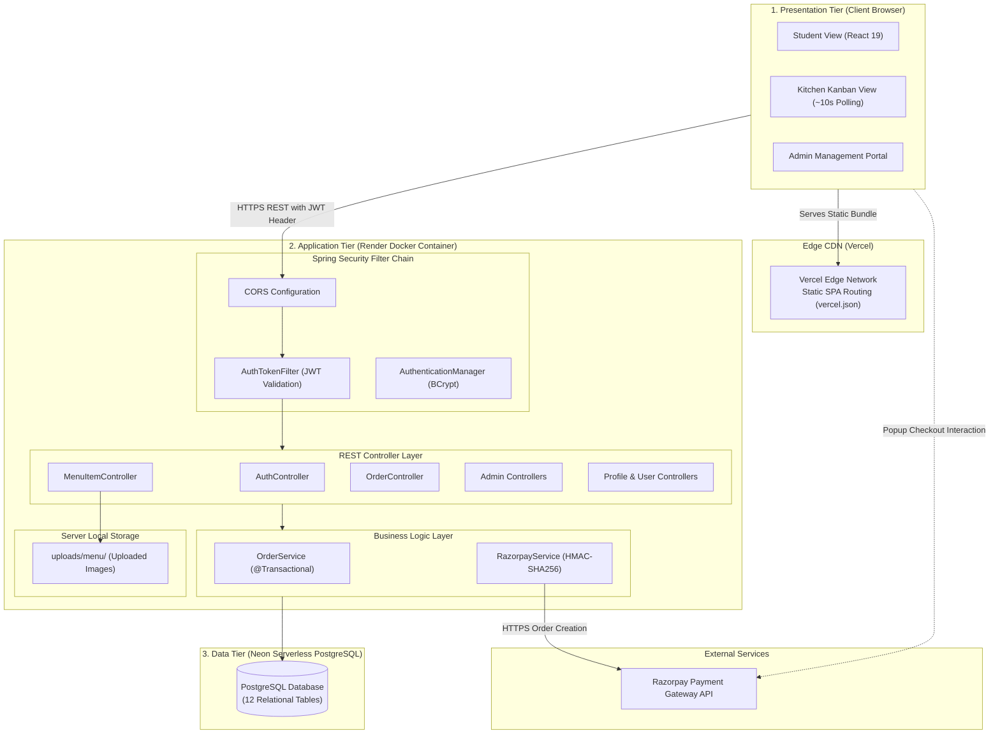
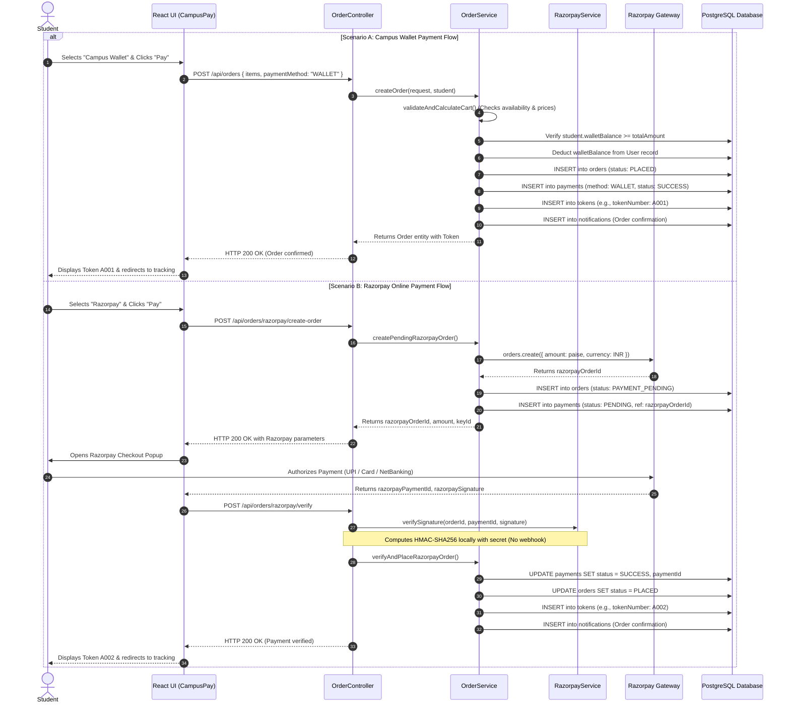
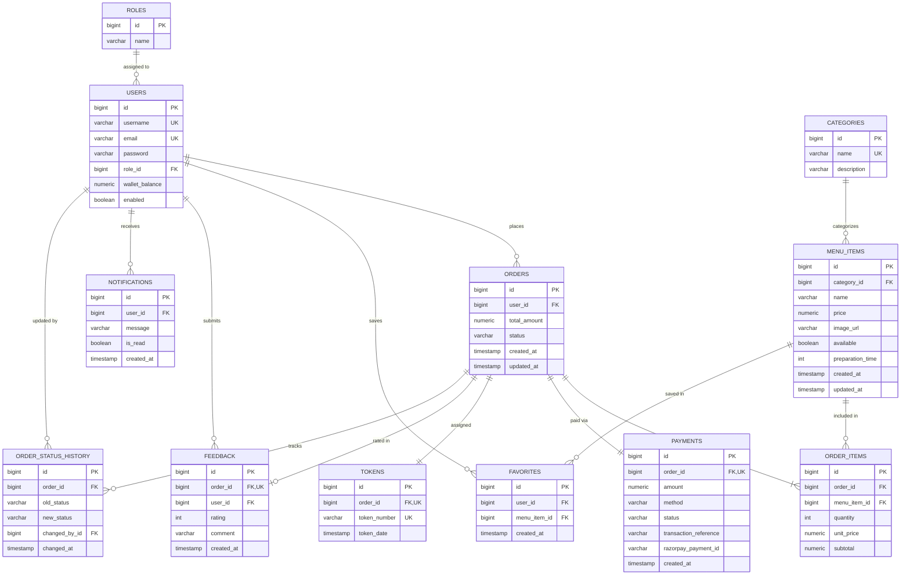

# BunkBites: Comprehensive Project Master Reference Manual

**Document Version:** 1.1.0  
**Project Repository:** [https://github.com/akashenguva30-cpu/BunkBites](https://github.com/akashenguva30-cpu/BunkBites)  
**Project Root Directory:** `C:\smart-campus-canteen`  
**Primary Source Document:** `BunkBites_Project_Audit.md`  
**Target Audience:** Project teammates, academic examiners, project guides, viva evaluators  
**Scope:** Architecture, implementation reference, database design, API specification, workflows, testing record, deployment, viva preparation, and academic presentation guide.

---

## Status Classification Legend
To maintain strict academic integrity and engineering accuracy, all statements throughout this document follow these explicit classification labels:
- `[IMPLEMENTED]`: Confirmed directly in the codebase files (controllers, entities, components, configuration).
- `[TESTED]`: Confirmed through recorded test execution (e.g., Maven test run, Vite build, or linter execution).
- `[PROPOSED]`: Conceptual or recommended future enhancement not currently present in the source code.
- `[UNVERIFIED]`: Statement or assumption based on external context that could not be independently inspected or verified locally (e.g., live cloud database contents, real-money live gateway transactions).

---

## 1. Project at a Glance

### 1.1 Project Title
**BunkBites: A Smart Campus Canteen Pre-Ordering, Digital Queue Management, and Multi-Channel Payment System**

### 1.2 Short Description
BunkBites is a full-stack campus web application designed to digitize the physical college canteen counter. It allows students to browse live menu availability, place orders online, pay via an internal student wallet or Razorpay payment gateway, receive an alphanumeric pickup token (e.g., `A001`), and track their queue position via periodic refresh (~10-second HTTP polling). Kitchen staff manage incoming orders using an operational Kanban board, while administrators oversee menu inventory, financial transaction ledgers, and staff provisioning.

### 1.3 Problem Being Addressed
- Severe queue congestion during short 15–30 minute class break intervals.
- Lost, mixed-up, or illegible handwritten counter paper slips.
- Cash-change bottlenecks and manual accounting friction at checkout.
- Zero student visibility into food preparation status or sold-out items before standing in line.
- Kitchen disorganization and inability to predict meal prep loads.

### 1.4 Objectives
- Provide a responsive clientside web portal for menu discovery, item favoriting, and pre-ordering `[IMPLEMENTED]`.
- Enforce strict order lifecycle states (`PLACED` → `ACCEPTED` → `PREPARING` → `READY` → `COLLECTED`) with an audit history log `[IMPLEMENTED]`.
- Provide automated order tokens and a periodically refreshed queue estimation engine (~10-second polling) `[IMPLEMENTED]`.
- Support dual payment mechanisms: Campus Wallet (instant balance deduction and automatic balance refund) and Razorpay gateway integration (order generation and client checkout signature verification; gateway refunds not automated) `[IMPLEMENTED]`.
- Offer a dedicated kitchen operations view with immediate item availability toggling `[IMPLEMENTED]`.
- Deliver administrative reporting for daily revenue, active orders, and item popularity `[IMPLEMENTED]`.

### 1.5 Target Users
1. **Students (`ROLE_STUDENT`):** Pre-order meals, track token queue position, manage wallet balance, view notifications, and review collected meals.
2. **Kitchen Staff (`ROLE_STAFF`):** Monitor orders on a Kanban board, advance order statuses, reject invalid orders, and toggle food item availability.
3. **Canteen Administrator (`ROLE_ADMIN`):** Manage menu items and categories, upload food images, monitor payment and order ledgers, and provision staff accounts.

### 1.6 Core Implemented Features
- **Stateless JWT Authentication & RBAC:** Role-based access control with BCrypt password hashing `[IMPLEMENTED]`.
- **Smart Menu Discovery:** Categorized menu with search, price/time filters, 30-day popularity aggregation, and campus slogans `[IMPLEMENTED]`.
- **Dual Payment Flow:** Instant campus wallet with automated balance refunds on rejection/cancellation, plus Razorpay checkout with cryptographic HMAC-SHA256 signature verification. (Note: External gateway refunds for Razorpay are not automated in code) `[IMPLEMENTED]`.
- **Digital Token & Queue Estimation:** Alphanumeric token numbering and calculation of active orders ahead (refreshed via client-side polling) `[IMPLEMENTED]`.
- **Kitchen Kanban Operations:** Interactive three-column order advancement board with stock toggles (periodically refreshed every 10 seconds) `[IMPLEMENTED]`.
- **In-App Notification Feed:** Category-coded alerts (green for ready, orange for prep, red for cancel/reject) `[IMPLEMENTED]`.
- **Post-Collection Reviews:** 1–5 star rating system updating aggregate menu scores `[IMPLEMENTED]`.
- **Administrative Control Panel:** Metrics dashboard, payment reconciliation ledger, and user enablement toggling `[IMPLEMENTED]`.

### 1.7 Current Technology Stack Summary
- **Frontend:** React 19 (`19.2.8`), Vite 8 (`8.3.1`), React Router DOM v7 (`7.18.4`), Axios (`1.20.0`), Vanilla CSS design tokens.
- **Backend:** Java 21 OpenJDK, Spring Boot 3.3.4, Spring Data JPA, Spring Security, JJWT (`0.12.5`), Razorpay SDK (`1.4.6`).
- **Database:** PostgreSQL (Neon serverless cloud in production; local PostgreSQL in development).
- **Deployment:** Docker multi-stage containerization on Render (backend) and global edge CDN on Vercel (frontend).

### 1.8 Current Deployment Architecture
```
[ User Browser ]
       │
       ├─────────────────────────┐
       ▼ (HTTPS)                 ▼ (API Calls: HTTPS)
[ Vercel Edge Network ]    [ Render Cloud Service ]
  Static React 19 SPA        Dockerized Spring Boot 3.3.4
  Single-Page App            REST API (Port 8080)
                             │
                             ├──────────────────────────┐
                             ▼ (Encrypted JDBC)         ▼ (HTTPS API / Signature Checks)
                       [ Neon PostgreSQL ]       [ Razorpay Gateway ]
                         Serverless Database       Payment Processing
```

### 1.9 Academic Abstract
> **Abstract:**  
> Traditional higher-education dining facilities frequently experience operational paralysis during peak transition breaks due to manual cashiering, paper-based order management, and uncoordinated preparation queues. This project presents **BunkBites**, a cloud-enabled, full-stack campus canteen management system developed using React 19, Spring Boot 3.3.4, and PostgreSQL. BunkBites decouples order intake from kitchen fulfillment through a responsive web interface featuring stateless JSON Web Token (JWT) role-based security, automated alphanumeric token generation, and an active queue estimation algorithm periodically refreshed via HTTP polling. The system incorporates a dual payment architecture comprising an internal simulated student wallet and external Razorpay gateway integration verified via cryptographic HMAC-SHA256 message authentication codes. Kitchen operations are orchestrated through a periodically refreshed Kanban interface enforcing strict state-machine transitions and automated campus wallet balance refund triggers (with manual handling required for external gateway transactions), backed by an immutable status audit ledger. Application containerization is achieved using Docker on Render, with static edge delivery via Vercel. Dynamic testing confirmed Spring Boot application startup and context stability (HikariCP connection pool, JPA repository bootstrapping) alongside clean frontend production compilation, demonstrating a viable, full-stack solution for modernizing campus food service logistics.

---

## 2. Problem Statement and Proposed Solution

### 2.1 The Traditional Campus Canteen Problem
In typical university canteens, several hundred students arrive simultaneously during 15-to-30-minute lecture breaks. This operational reality creates severe bottlenecks:
1. **Queue Stacking:** A single student at the front of the line deciding what to order or counting cash delays dozens of students behind them.
2. **Information Asymmetry:** Students have no way of knowing whether an item (e.g., Chicken Biryani) is sold out until reaching the counter.
3. **Misplaced Tickets & Human Error:** Handwritten paper slips or shouted verbal orders lead to forgotten tickets, kitchen confusion, and student dissatisfaction.
4. **Accounting Discrepancies:** Manual cash collection creates reconciliation errors, delays cashier throughput, and complicates financial auditing.
5. **Kitchen Stress:** Cooks receive orders in irregular bursts rather than a structured digital queue, preventing optimal food batching and preparation planning.

### 2.2 Proposed Digital Solution (BunkBites Workflow)
BunkBites replaces the physical order desk with a distributed, pre-ordering web portal:
1. **Remote Ordering:** Students view currently available items with live pricing, preparation time estimates, and ratings from their smartphones or laptops before visiting the canteen.
2. **Instant Payment & Token Issuance:** Students pay via Campus Wallet or Razorpay. Upon confirmation, the backend generates an alphanumeric token (e.g., `A005`).
3. **Transparent Queue Tracking:** Students remain in their classrooms or study areas while checking their order queue position (`ordersAhead` count, periodically refreshed via ~10-second polling) on their phones.
4. **Kitchen Operations (Kanban):** Kitchen staff view orders in structured columns (*New*, *Preparing*, *Ready*), refreshed periodically via polling. Staff click "Start Preparing" when cooking begins and "Mark Ready" when plated.
5. **Notification & Pickup:** The student receives an in-app alert when their order is marked `READY`, walks to the pickup counter, presents token `A005`, and collects the meal.
6. **Post-Collection Feedback:** Once collected, the student can rate the meal 1 to 5 stars, feeding into aggregate item scores.

### 2.3 Intended Benefits vs. Unverified Assumptions
To maintain academic honesty, differentiate planned goals from empirical measurements:
- **Intended Qualitative Benefits:** Eliminates physical counter crowding; provides automated bookkeeping; gives kitchen staff advance visibility of demand; reduces manual cash handling errors.
- **Academic Caution Note:** While the digital workflow is logically designed to reduce counter wait times and improve throughput, **do not cite specific statistical claims** (e.g., *"reduces wait times by 75%"* or *"delivers sub-millisecond low-latency updates"*) in reports or presentations unless your team conducts a controlled timing study comparing baseline manual times against BunkBites usage. Real-time updates currently rely on periodic 10-second polling rather than push messaging.

---

## 3. Features by User Role

### 3.1 Student Functionality (`ROLE_STUDENT`)
| Feature | Plain-English Explanation | Technical Implementation Details | Status |
| :--- | :--- | :--- | :---: |
| **Account Registration** | Students sign up using a username, email, and password. | `POST /api/auth/register`, defaults to `ROLE_STUDENT`, creates account with default ₹500.00 wallet balance. | `[IMPLEMENTED]` |
| **User Sign-In** | Authenticates user credentials and issues a signed, stateless 24-hour JWT token. | `POST /api/auth/login`, validates credentials via BCrypt, issues signed JWT token saved in `sessionStorage`. | `[IMPLEMENTED]` |
| **Menu Browsing & Search** | Browse foods categorized with photos, preparation times, prices, and star ratings. Filter by keyword. | `GET /api/menu/available`, queries database with `available = true`, accepts `categoryId` and `search` query parameters. | `[IMPLEMENTED]` |
| **Campus Smart Feeds** | Curated horizontal scrolling feeds for fast discovery. | Feeds: *Your Favourites*, *Popular on Campus* (derived from 30-day top sales query), *Quick Bites (<10 mins)*, *Budget Friendly (<₹100)*. | `[IMPLEMENTED]` |
| **Slogan Engine** | Playful campus-themed banner headlines rotating dynamically. | Clientside `sloganEngine.js` picks slogans from `slogans.js` and stores history in `sessionStorage` to prevent immediate repetition. | `[IMPLEMENTED]` |
| **Favorites Management** | Click heart icon to save favorite items for one-click access. | `POST`/`DELETE /api/favorites/{menuItemId}`, stored in `favorites` table with composite unique constraint `(user_id, menu_item_id)`. | `[IMPLEMENTED]` |
| **Interactive Cart** | Add multiple items, adjust quantities, calculate subtotal and grand total. | Clientside state management in `StudentMenu.jsx` passing structured cart array to checkout modal. | `[IMPLEMENTED]` |
| **Campus Wallet Checkout** | Instant payment deduction from student pre-loaded balance. | `POST /api/orders`, server validates cart availability, verifies `walletBalance >= total`, decrements balance within transaction. | `[IMPLEMENTED]` |
| **Razorpay Checkout** | Online payment via UPI, Debit/Credit Card, or Net Banking. | `POST /api/orders/razorpay/create-order` creates pending order; client launches Razorpay modal; `verify` endpoint checks HMAC signature. | `[IMPLEMENTED]` |
| **Order Token Generation** | Unique pickup code assigned to order for counter verification. | Formats token as `A%03d` based on count from `TokenRepository`. | `[IMPLEMENTED]` |
| **Periodic Queue Tracking** | Shows current token being prepared and number of orders ahead. | `GET /api/orders/{id}/queue`, queries same-day active orders created before current order; client polls at ~10-second intervals (not push-based). | `[IMPLEMENTED]` |
| **Visual Order Timeline** | Chronological visual progress tracker for order preparation stages. | Reads timestamps from `order_status_history` table to render node states (*Placed*, *Accepted*, *Preparing*, *Ready*, *Collected*). | `[IMPLEMENTED]` |
| **Order Cancellation** | Cancel order if kitchen has not started cooking. | `PUT /api/orders/{id}/cancel`, permitted only while order status is `PLACED`. Wallet balance is automatically restored. (External Razorpay gateway refunds are not automated). | `[IMPLEMENTED]` |
| **Order History** | Tabbed ledger displaying active and historical orders. | `GET /api/orders`, splits orders into Active (`PLACED`, `ACCEPTED`, `PREPARING`, `READY`) and Past (`COLLECTED`, `CANCELLED`, `REJECTED`). | `[IMPLEMENTED]` |
| **In-App Notification Feed** | Status update alerts with color-coded badges fetched on demand. | `GET /api/notifications`, grouped into *Today*, *Yesterday*, and *Older*; supports mark-as-read and mark-all-as-read. | `[IMPLEMENTED]` |
| **Star Review & Feedback** | Submit 1–5 star rating with optional comment after collecting food. | `POST /api/feedback`, validated only when order status is `COLLECTED`. Enforces one review per order via unique foreign key. | `[IMPLEMENTED]` |
| **Profile & Security** | View profile, update email address, and change account password. | `GET`/`PUT /api/profile` and `PUT /api/profile/password` (verifies current password before hashing new password). | `[IMPLEMENTED]` |

### 3.2 Kitchen Staff Functionality (`ROLE_STAFF`)
| Feature | Plain-English Explanation | Technical Implementation Details | Status |
| :--- | :--- | :--- | :---: |
| **Staff Sign-In** | Staff member logs in and is routed directly to the kitchen board. | `POST /api/auth/login`, redirects role `ROLE_STAFF` to `/staff/orders`. | `[IMPLEMENTED]` |
| **Kitchen Kanban Board** | Orders organized in 3 columns: *New Orders*, *Preparing*, *Ready*. | `GET /api/orders/all`, filtered client-side into Kanban columns; auto-refreshes every 10 seconds via HTTP polling. | `[IMPLEMENTED]` |
| **Order Advancement** | Move order through production: Accept, Start Prep, Mark Ready, Collect. | `PUT /api/orders/{id}/status`, enforces strict state machine progression. | `[IMPLEMENTED]` |
| **Order Rejection & Refund** | Kitchen can reject an order if out of stock; triggers refund handling. | Rejection sets `PaymentStatus.REFUNDED` and restores student Campus Wallet balance immediately. (Gateway refunds for Razorpay are not automated). | `[IMPLEMENTED]` |
| **Quick Stock Availability Toggle** | Enable or disable menu items instantly from kitchen view. | `PUT /api/menu/{id}`, updates `available` boolean so students cannot purchase sold-out items. | `[IMPLEMENTED]` |
| **Order History Drawer** | View completed, rejected, and cancelled orders. | Filter orders by status (`ALL`, `COLLECTED`, `CANCELLED`, `REJECTED`). | `[IMPLEMENTED]` |

### 3.3 Administrator Functionality (`ROLE_ADMIN`)
| Feature | Plain-English Explanation | Technical Implementation Details | Status |
| :--- | :--- | :--- | :---: |
| **Canteen Control Dashboard** | Central dashboard showing daily revenue, order volume, and top items. | `GET /api/admin/dashboard`, aggregates same-day statistics using SQL JPQL queries in `OrderRepository`. | `[IMPLEMENTED]` |
| **Menu Item Management** | Add, edit, or delete food items with price, prep time, and category. | Full CRUD via `MenuItemController.java` (`POST`, `PUT`, `DELETE /api/menu`). | `[IMPLEMENTED]` |
| **Image Upload System** | Upload food dish photographs from local device. | `POST /api/menu/upload-image`, checks JPEG/PNG/WEBP MIME types, generates UUID filename, saves to `uploads/menu` on local container storage. | `[IMPLEMENTED]` |
| **Category Management** | Create, edit, and delete food categories (e.g., *Meals*, *Snacks*, *Beverages*). | Full CRUD via `CategoryController.java` with name uniqueness validation. | `[IMPLEMENTED]` |
| **Master Order Ledger** | Comprehensive searchable table of every order placed in the canteen. | `GET /api/admin/orders`, supports text search (by ID, student username, token) and status filtering. | `[IMPLEMENTED]` |
| **Master Payment Ledger** | Financial ledger of all transactions with revenue and refund summaries. | `GET /api/admin/payments`, displays today's revenue, successful count, refunded amount, and failed transaction counts. | `[IMPLEMENTED]` |
| **User & Staff Provisioning** | View all users, register new staff accounts, enable/disable access. | `GET /api/admin/users`, `POST /api/admin/users/staff` (creates `ROLE_STAFF`), `PUT /api/admin/users/{id}/status`. Prevents admin from disabling their own account. | `[IMPLEMENTED]` |
| **Kitchen View Access** | Admins can switch into the kitchen view at any time. | Linked in `AdminSidebar.jsx` with full operational permissions. | `[IMPLEMENTED]` |

---

## 4. System Architecture

### 4.1 High-Level Architecture Explanation
BunkBites follows a clean, decoupled **Client-Server 3-Tier Architecture**:
1. **Presentation Tier (React 19 SPA):**  
   Runs in the user's browser. Built with Vite into static HTML, JavaScript, and CSS bundles hosted on Vercel's Edge Network. Handles routing, client state, form validation, and periodic HTTP polling.
2. **Application Tier (Spring Boot 3.3.4):**  
   Java 21 backend packaged into an executable JAR inside an `eclipse-temurin:21` Docker container hosted on Render. Exposes stateless REST endpoints under `/api/**`. Contains Spring Security filters, business services, and transaction boundaries.
3. **Data Tier (PostgreSQL):**  
   Relational database hosted on Neon Cloud (or local PostgreSQL during development). Manages relational tables, foreign key constraints, unique indexes, and ACID-compliant transaction persistence.
4. **Third-Party Service (Razorpay Payment Gateway):**  
   External payment processor invoked for online digital currency transactions (orders created via SDK, checkout verified via client signature parameters; webhooks not implemented).

### 4.2 System Architecture Diagram


### 4.3 End-to-End Order & Payment Data-Flow Diagram


---

## 5. Technology Stack Reference

| Technology | Verified Version | Layer / Role | Purpose & Engineering Justification | Status |
| :--- | :---: | :--- | :--- | :---: |
| **Java OpenJDK** | 21 (LTS) | Backend Runtime | LTS runtime providing pattern matching, virtual thread support, record classes, and robust performance. | `[IMPLEMENTED]` |
| **Spring Boot** | 3.3.4 | Backend Framework | Rapid enterprise Java development, autoconfiguration, embedded Tomcat 10, and dependency injection. | `[IMPLEMENTED]` |
| **Spring Data JPA** | 3.3.4 (Boot) | Persistence / ORM | Implements Object-Relational Mapping (Hibernate 6.5) and generates repository queries. | `[IMPLEMENTED]` |
| **Spring Security** | 3.3.4 (Boot) | Security Layer | Provides declarative method-level authorization (`@PreAuthorize`) and stateless filter interception. | `[IMPLEMENTED]` |
| **PostgreSQL** | 15 / 16 | Relational Database | ACID-compliant relational storage supporting check constraints, composite keys, and aggregations. | `[IMPLEMENTED]` |
| **JJWT (`io.jsonwebtoken`)** | 0.12.5 | Token Security | Cryptographic HMAC-SHA256 signing, claims serialization, and verification for stateless authentication. | `[IMPLEMENTED]` |
| **Razorpay Java SDK** | 1.4.6 | Payment Gateway | Server integration for creating online payment orders and verifying client checkout signatures via HMAC-SHA256 (webhook verification not implemented). | `[IMPLEMENTED]` |
| **Spring Dotenv** | 4.0.0 | Configuration | Automatically parses `.env` files into Spring Environment properties for local development. | `[IMPLEMENTED]` |
| **React** | 19.2.8 | Frontend Framework | Declarative virtual-DOM UI library for building responsive, component-based user interfaces. | `[IMPLEMENTED]` |
| **Vite** | 8.3.1 | Build Tooling | High-speed ESM development server and Rollup production bundler. | `[IMPLEMENTED]` |
| **React Router DOM** | 7.18.4 | Client-side Router | Client-side routing, protected route guards, and URL parameter handling. | `[IMPLEMENTED]` |
| **Axios** | 1.20.0 | HTTP Client | Promise-based HTTP client with request interceptors for automatic JWT header injection. | `[IMPLEMENTED]` |
| **Vanilla CSS** | CSS3 | UI Styling | High performance, lightweight design tokens without bloated utility-class frameworks. | `[IMPLEMENTED]` |
| **Docker** | Multi-stage | Containerization | Builds an optimized container with Temurin-21 JRE, ensuring environment parity between dev and Render. | `[IMPLEMENTED]` |
| **Render** | Cloud PaaS | Backend Hosting | Runs the containerized Spring Boot backend service with environment variables. | `[IMPLEMENTED]` |
| **Vercel** | Edge CDN | Frontend Hosting | Distributes static Vite assets with rewrite routing for single-page application navigation. | `[IMPLEMENTED]` |

---

## 6. Frontend Reference

### 6.1 Application Structure (`frontend/src/`)
```
frontend/src/
├── api/
│   └── axiosConfig.js          # Centralized Axios instance & JWT interceptor
├── assets/
│   └── brand/                  # Official SVGs & PNG logo assets
├── components/
│   ├── AdminSidebar.jsx        # Sidebar navigation for Administrator
│   ├── CampusPay.jsx           # Multi-step checkout & payment modal
│   ├── OrderRating.jsx         # Star-rating submission component
│   └── StudentNavbar.jsx       # Top navigation header for students & staff
├── data/
│   └── slogans.js              # Bank of campus canteen slogans
├── pages/
│   ├── Login.jsx               # Username/password sign-in page
│   ├── Register.jsx            # Student account creation page
│   ├── StudentMenu.jsx         # Food menu, search, category chips, cart
│   ├── StudentFavorites.jsx    # Saved favorite food items page
│   ├── OrderHistory.jsx        # Tabbed view for active and past orders
│   ├── StudentOrderDetails.jsx # Queue tracking (~10s polling), timeline, review form
│   ├── StudentNotifications.jsx# In-app notification list
│   ├── Profile.jsx             # Personal profile & password update
│   ├── StaffOrders.jsx         # Kitchen operations Kanban board (~10s polling)
│   ├── AdminDashboard.jsx      # Daily executive revenue & stats dashboard
│   ├── AdminMenu.jsx           # Menu CRUD & image upload interface
│   ├── AdminOrders.jsx         # Master filterable order ledger
│   ├── AdminPayments.jsx       # Financial ledger & revenue calculations
│   └── AdminUsers.jsx          # User accounts, staff creation & toggles
├── utils/
│   ├── imageUtils.js           # Resolves absolute image URLs from backend origin
│   └── sloganEngine.js         # Non-repeating randomized slogan selector
├── App.jsx                     # Router declaration & ProtectedRoute guards
├── index.css                   # Global CSS variables (design system tokens)
└── main.jsx                    # React application entry point
```

### 6.2 Protected Route Guard Architecture (`App.jsx`)
Access to views is controlled using a custom wrapper component that inspects browser `sessionStorage`:
```jsx
const ProtectedRoute = ({ children, allowedRoles }) => {
  const token = sessionStorage.getItem('token');
  const role = sessionStorage.getItem('role');

  if (!token) return <Navigate to="/" />;
  if (allowedRoles && !allowedRoles.includes(role)) return <Navigate to="/" />;
  
  return children;
};
```
- If a user attempts to access `/admin/dashboard` while having `role === 'ROLE_STUDENT'`, they are redirected to `/`.
- If an unauthenticated user attempts to access `/student`, they are redirected to `/`.

### 6.3 API Communication & JWT Interceptor (`axiosConfig.js`)
All HTTP requests go through a unified Axios instance:
```javascript
import axios from 'axios';

const api = axios.create({
  baseURL: import.meta.env.VITE_API_URL || 'http://localhost:8080/api',
});

api.interceptors.request.use((config) => {
  const token = sessionStorage.getItem('token');
  if (token) {
    config.headers.Authorization = `Bearer ${token}`;
  }
  return config;
});

export default api;
```

### 6.4 Image & Static Asset Handling (`imageUtils.js`)
Because menu dish images can be uploaded dynamically to the backend server, the frontend extracts the origin from `VITE_API_URL` to resolve relative upload paths:
- Relative path: `/uploads/menu/image-uuid.jpg`
- Transformed path: `https://<backend-host>/uploads/menu/image-uuid.jpg`
- External URLs (starting with `http://` or `https://`) pass through unchanged.

---

## 7. Backend Reference

### 7.1 Layer Responsibilities

#### 1. Controller Layer (`com.campus.canteen.controller`)
- Defines REST endpoints using `@RestController` and `@RequestMapping`.
- Annotates endpoints with `@PreAuthorize` to enforce role requirements at the method level.
- Validates request payloads with `@Valid` annotations.
- Converts between HTTP requests/responses and internal Data Transfer Objects (DTOs).

#### 2. Service Layer (`com.campus.canteen.service`)
- Enforces core business logic (cart price calculation, stock availability check, wallet balance deduction, status state machine rules).
- Manages transactional boundaries using `@Transactional` to guarantee database consistency upon errors.
- Coordinates external service integrations (`RazorpayService`).

#### 3. Repository Layer (`com.campus.canteen.repository`)
- Extends Spring Data JPA's `JpaRepository<Entity, ID>`.
- Provides derived query methods (e.g., `findByStudentIdOrderByCreatedAtDesc`).
- Executes custom JPQL aggregate queries for daily revenue sums, popular items, and queue depth counts.

#### 4. Model / Entity Layer (`com.campus.canteen.model`)
- Defines JPA `@Entity` classes mapped to PostgreSQL database tables.
- Annotates relationships (`@OneToOne`, `@OneToMany`, `@ManyToOne`) with cascading rules.
- Manages automated timestamps via `@CreationTimestamp` and `@PrePersist`.

### 7.2 Key Business Logic Implementations

#### 1. Cart Validation and Price Calculation (`OrderService.java`)
```java
public CartValidationResult validateAndCalculateCart(List<OrderRequest.OrderItemRequest> itemsReq) {
    List<OrderItem> orderItems = new ArrayList<>();
    BigDecimal totalAmount = BigDecimal.ZERO;

    for (OrderRequest.OrderItemRequest itemReq : itemsReq) {
        MenuItem menuItem = menuItemRepository.findById(itemReq.getMenuItemId()).orElse(null);
        if (menuItem == null || !menuItem.isAvailable()) {
            throw new IllegalArgumentException("Error: Item unavailable or not found");
        }
        OrderItem orderItem = new OrderItem();
        orderItem.setMenuItem(menuItem);
        orderItem.setQuantity(itemReq.getQuantity());
        orderItem.setUnitPrice(menuItem.getPrice());
        
        BigDecimal subtotal = menuItem.getPrice().multiply(BigDecimal.valueOf(itemReq.getQuantity()));
        orderItem.setSubtotal(subtotal);
        orderItems.add(orderItem);

        totalAmount = totalAmount.add(subtotal);
    }
    return new CartValidationResult(orderItems, totalAmount);
}
```
> **Concurrency & Transaction Scope Note:** The calling method `createOrder` is annotated with Spring's `@Transactional`, which ensures all database operations (order insert, line items, wallet balance deduction, token generation) execute as an all-or-nothing unit with automatic rollback upon exceptions. However, `@Transactional` alone does not implement concurrency locks (such as database pessimistic locking `PESSIMISTIC_WRITE` or optimistic `@Version` checks) on `MenuItem` records. If multiple users simultaneously submit orders for an item right before staff marks it unavailable, both could pass the `isAvailable()` check before either completes.

#### 2. Order State Machine Transition Enforcement (`OrderService.java`)
The system strictly prevents illegal transitions (e.g., an order cannot jump from `PLACED` directly to `READY`):
```java
boolean valid = false;
if (oldStatus == OrderStatus.PLACED && (newStatus == OrderStatus.ACCEPTED || newStatus == OrderStatus.REJECTED)) valid = true;
if (oldStatus == OrderStatus.ACCEPTED && newStatus == OrderStatus.PREPARING) valid = true;
if (oldStatus == OrderStatus.PREPARING && newStatus == OrderStatus.READY) valid = true;
if (oldStatus == OrderStatus.READY && newStatus == OrderStatus.COLLECTED) valid = true;

if (!valid) {
    throw new IllegalArgumentException("Error: Invalid status transition from " + oldStatus + " to " + newStatus);
}
```

#### 3. Cryptographic Signature Verification (`RazorpayService.java`)
```java
public boolean verifySignature(String razorpayOrderId, String razorpayPaymentId, String razorpaySignature) {
    try {
        JSONObject options = new JSONObject();
        options.put("razorpay_order_id", razorpayOrderId);
        options.put("razorpay_payment_id", razorpayPaymentId);
        options.put("razorpay_signature", razorpaySignature);
        return com.razorpay.Utils.verifyPaymentSignature(options, keySecret);
    } catch (Exception e) {
        return false;
    }
}
```
> **Signature Verification Note:** Signature verification is performed locally on the server using `com.razorpay.Utils.verifyPaymentSignature()`, which calculates the HMAC-SHA256 hash using the local `keySecret` and compares it to `razorpaySignature`. It does not make an outbound network call to Razorpay, nor does the system implement an inbound Razorpay webhook endpoint.

---

## 8. Database Design

### 8.1 Schema Overview & Verification Note
- **Schema Management:** Driven by Hibernate ORM (`spring.jpa.hibernate.ddl-auto=update`).
- **Audit Verification Distinction:** The entity models, fields, constraints, and relationships documented below were verified by inspecting Java JPA entity source files in `com.campus.canteen.model`. They reflect the application's declared persistence model. (A direct catalog query of the remote Neon cloud database was not executed to prevent external credential dependencies).
- **Academic Normalization Note:** While the relational schema is normalized through separation of entities (`orders`, `order_items`, `payments`, `tokens`), **do not claim formal mathematical 3NF proof** unless your report includes a detailed functional dependency analysis.

### 8.2 Entity-Relationship (ER) Diagram


### 8.3 Relational Entity Specifications
1. **`roles`:** Stores system user roles (`ROLE_STUDENT`, `ROLE_STAFF`, `ROLE_ADMIN`).
2. **`users`:** Stores credentials, hashed password, role association, wallet balance (default `500.00`), and active enablement flag. Unique constraints on `username` and `email`.
3. **`categories`:** Groups food items (e.g., *Meals*, *Snacks*, *Beverages*). Unique constraint on category `name`.
4. **`menu_items`:** Individual food offerings with category reference, price, prep time, availability status, and image URL. Contains transient (non-persisted) fields `averageRating` and `ratingCount` computed on read.
5. **`orders`:** Core transaction record linking student to overall order status, total price, and timestamps.
6. **`order_items`:** Line-item breakdown linking orders to specific menu items, capturing purchased unit price, quantity, and subtotal.
7. **`payments`:** Financial record tied 1-to-1 with an order. Records payment method (`WALLET`, `RAZORPAY`, `UPI`, `CARD`, `CASH`, `NET_BANKING`), status (`PENDING`, `SUCCESS`, `FAILED`, `REFUNDED`), and gateway identifiers.
8. **`tokens`:** Canteen order pickup token (e.g., `A001`). 1-to-1 relationship with `orders`.
9. **`order_status_history`:** Audit ledger capturing every state change (`oldStatus`, `newStatus`, `changedBy`, `changedAt`).
10. **`feedback`:** Star ratings (1 to 5) and comments. 1-to-1 relationship with `orders` enforced via unique constraint on `order_id`.
11. **`favorites`:** Student saved menu items. Unique composite key on `(user_id, menu_item_id)`.
12. **`notifications`:** In-app updates for order progress with an unread boolean flag.

---

## 9. API Reference

All endpoints below are verified against the Spring Boot `@RestController` implementations:

### 9.1 Authentication Module (`AuthController.java`)
| Method | Path | Required Role | Request Body | Purpose |
| :--- | :--- | :---: | :--- | :--- |
| `POST` | `/api/auth/login` | Public | `LoginRequest` | Authenticates user credentials; returns JWT token, ID, username, email, role. |
| `POST` | `/api/auth/register` | Public | `SignupRequest` | Registers new student with `ROLE_STUDENT` and default wallet balance. |
| `GET` | `/api/auth/me` | Authenticated | None | Returns profile info and current `walletBalance` for logged-in user. |

### 9.2 Categories & Menu Module (`CategoryController.java`, `MenuItemController.java`)
| Method | Path | Required Role | Request Body | Purpose |
| :--- | :--- | :---: | :--- | :--- |
| `GET` | `/api/categories` | Student, Staff, Admin | None | Retrieves all menu categories. |
| `GET` | `/api/categories/{id}`| Student, Staff, Admin | None | Retrieves a specific category by ID. |
| `POST` | `/api/categories` | Staff, Admin | `CategoryRequest` | Creates a new category (name must be unique). |
| `PUT` | `/api/categories/{id}`| Staff, Admin | `CategoryRequest` | Updates category name and description. |
| `DELETE`| `/api/categories/{id}`| Staff, Admin | None | Deletes category by ID. |
| `GET` | `/api/menu` | Student, Staff, Admin | None | Returns menu items with dynamic star rating and count. |
| `GET` | `/api/menu/available`| Student, Staff, Admin | None | Returns only food items marked `available == true`. |
| `GET` | `/api/menu/popular-ids`| Student, Staff, Admin | None | Returns IDs of top-selling items over the last 30 days. |
| `GET` | `/api/menu/{id}` | Student, Staff, Admin | None | Retrieves single food item by ID. |
| `POST` | `/api/menu/upload-image`| Admin | Multipart Form | Uploads JPEG/PNG/WEBP food image to container storage; returns file URL path. |
| `POST` | `/api/menu` | Staff, Admin | `MenuItemRequest` | Creates a new menu item. |
| `PUT` | `/api/menu/{id}` | Staff, Admin | `MenuItemRequest` | Updates menu item details and availability flag. |
| `DELETE`| `/api/menu/{id}` | Staff, Admin | None | Deletes a menu item by ID. |

### 9.3 Orders & Queue Module (`OrderController.java`)
| Method | Path | Required Role | Request Body | Purpose |
| :--- | :--- | :---: | :--- | :--- |
| `POST` | `/api/orders` | Student | `OrderRequest` | Creates an order using Campus Wallet or simulated payment. |
| `POST` | `/api/orders/razorpay/create-order` | Student | `OrderRequest` | Initiates pending order and requests Razorpay gateway order ID. |
| `POST` | `/api/orders/razorpay/verify` | Student | `RazorpayVerificationRequest` | Validates HMAC signature locally, marks order `PLACED`, assigns token. |
| `GET` | `/api/orders` | Student | None | Lists order history for logged-in student (latest first). |
| `GET` | `/api/orders/{id}` | Student, Staff, Admin | None | Fetches order details (verifies student ownership if student). |
| `GET` | `/api/orders/{id}/queue` | Student | None | Returns token, `ordersAhead` count, `currentToken`, and `isReady` (queried periodically via ~10s polling by frontend). |
| `GET` | `/api/orders/all` | Staff, Admin | None | Returns all orders sorted descending by creation time (polled periodically by kitchen view). |
| `PUT` | `/api/orders/{id}/status` | Staff, Admin | `OrderStatusUpdateRequest` | Advances order status; writes to history; sends student notification; handles wallet refunds on rejection. |
| `PUT` | `/api/orders/{id}/cancel` | Student | None | Cancels order (if in `PLACED` status); triggers wallet balance refund (gateway refunds not automated). |

### 9.4 Favorites, Feedback & Notifications (`FavoriteController`, `FeedbackController`, `NotificationController`)
| Method | Path | Required Role | Request Body | Purpose |
| :--- | :--- | :---: | :--- | :--- |
| `GET` | `/api/favorites` | Student | None | Retrieves list of student's favorited menu items. |
| `POST` | `/api/favorites/{menuItemId}` | Student | None | Adds menu item to student favorites. |
| `DELETE`| `/api/favorites/{menuItemId}` | Student | None | Removes menu item from student favorites. |
| `POST` | `/api/feedback` | Student | `FeedbackRequest` | Submits 1–5 star rating & comment for collected order. |
| `GET` | `/api/feedback/order/{orderId}` | Student, Staff, Admin | None | Retrieves feedback review for a specific order. |
| `GET` | `/api/feedback/all` | Admin | None | Lists all student reviews across all orders. |
| `GET` | `/api/notifications` | Student | None | Lists student notifications and unread alert count. |
| `PUT` | `/api/notifications/{id}/read` | Student | None | Marks specific notification as read. |
| `PUT` | `/api/notifications/read-all` | Student | None | Marks all unread notifications as read. |

### 9.5 Administration Module (`AdminController`, `AdminOrderController`, `AdminPaymentController`, `AdminUserController`)
| Method | Path | Required Role | Request Body | Purpose |
| :--- | :--- | :---: | :--- | :--- |
| `GET` | `/api/admin/dashboard` | Admin | None | Returns daily metrics (orders, revenue, active, cancelled, top 5 items). |
| `GET` | `/api/admin/orders` | Admin | Query Params | Returns filterable master order ledger (search, status). |
| `GET` | `/api/admin/orders/{id}` | Admin | None | Fetches single order details. |
| `GET` | `/api/admin/payments` | Admin | Query Params | Returns filterable master payment ledger (status, method, search). |
| `GET` | `/api/admin/payments/{id}`| Admin | None | Fetches single payment transaction record. |
| `GET` | `/api/admin/users` | Admin | Query Params | Lists users with search and role filter. |
| `POST` | `/api/admin/users/staff` | Admin | `Map<username, email, password>` | Creates a new kitchen staff account. |
| `PUT` | `/api/admin/users/{id}/status` | Admin | `Map<enabled>` | Enables or disables a user account (prevents self-disabling). |

---

## 10. Important End-to-End Workflows

### 10.1 Workflow 1: Student Registration & Authentication
1. Student enters username, email, and password on `/register` `[IMPLEMENTED]`.
2. Backend verifies email and username uniqueness in the `users` table `[IMPLEMENTED]`.
3. Password is encrypted using `BCryptPasswordEncoder` `[IMPLEMENTED]`.
4. User record is saved with `ROLE_STUDENT` and an initial wallet balance of ₹500.00 `[IMPLEMENTED]`.
5. Student logs in on `/` with username and password `[IMPLEMENTED]`.
6. Server validates credentials against the BCrypt hash via `AuthenticationManager` and returns a signed 24-hour stateless JWT `[IMPLEMENTED]`.
7. React client saves token and role in `sessionStorage` and attaches it to subsequent requests via the Axios interceptor `[IMPLEMENTED]`. (No server-side session or encrypted session state is created; all authorization is stateless and validated per request via the JWT signature).

### 10.2 Workflow 2: Menu Browsing & Cart Addition
1. `StudentMenu.jsx` fetches active categories and available items from `/api/menu/available` `[IMPLEMENTED]`.
2. Slogan banner loads a randomized campus phrase without immediate repetition `[IMPLEMENTED]`.
3. Student filters items by category chip or types a keyword into the search bar `[IMPLEMENTED]`.
4. Student clicks "Add to Cart" or heart icon (to save to favorites) `[IMPLEMENTED]`.
5. Student clicks the floating cart button to open the `CampusPay.jsx` checkout modal `[IMPLEMENTED]`.

### 10.3 Workflow 3: Campus Wallet Checkout
1. Student selects **Campus Wallet** in the checkout modal `[IMPLEMENTED]`.
2. Client checks that `walletBalance >= cartTotal` `[IMPLEMENTED]`.
3. Request dispatched to `POST /api/orders` with payment method `WALLET` `[IMPLEMENTED]`.
4. Server recalculates prices and confirms item availability during order creation inside a `@Transactional` method `[IMPLEMENTED]` (ensuring all-or-nothing database rollback, though without concurrency row locks).
5. Server verifies wallet balance, deducts order total, and saves updated user balance `[IMPLEMENTED]`.
6. Order record is created with status `PLACED` `[IMPLEMENTED]`.
7. Payment record is created with status `SUCCESS` `[IMPLEMENTED]`.
8. Sequential token string (e.g., `A001`) is generated and linked to the order `[IMPLEMENTED]`.
9. Confirmation notification is saved in `notifications` table `[IMPLEMENTED]`.
10. UI displays token confirmation card and directs student to order tracking `[IMPLEMENTED]`.

### 10.4 Workflow 4: Razorpay Online Payment & Signature Verification
1. Student selects **Razorpay** in checkout modal and clicks Continue `[IMPLEMENTED]`.
2. Client calls `POST /api/orders/razorpay/create-order` `[IMPLEMENTED]`.
3. Server calculates total in paise and calls Razorpay API: `orders.create()` `[IMPLEMENTED]`.
4. Server saves `Order` as `PAYMENT_PENDING` and `Payment` as `PENDING` with the Razorpay order ID `[IMPLEMENTED]`.
5. Client dynamically injects `https://checkout.razorpay.com/v1/checkout.js` and opens the gateway modal `[IMPLEMENTED]`.
6. Student completes transaction through Razorpay `[IMPLEMENTED in code; real-money gateway charges UNVERIFIED IN PRODUCTION]`.
7. Razorpay client script returns `razorpay_payment_id`, `razorpay_order_id`, and `razorpay_signature` `[IMPLEMENTED]`.
8. Client dispatches parameters to `POST /api/orders/razorpay/verify` `[IMPLEMENTED]`.
9. Server recalculates HMAC-SHA256 signature locally using internal `razorpay.key.secret` (no webhook used) `[IMPLEMENTED]`.
10. If signatures match, payment is marked `SUCCESS`, order becomes `PLACED`, token is assigned, and confirmation is returned `[IMPLEMENTED]`.

### 10.5 Workflow 5: Periodic Queue Estimation & Tracking (~10s HTTP Polling)
1. Student opens `/orders/:id` `[IMPLEMENTED]`.
2. Client requests `/api/orders/{id}/queue` `[IMPLEMENTED]`.
3. Backend determines the start and end of the current day `[IMPLEMENTED]`.
4. Backend finds all active orders (`PLACED`, `ACCEPTED`, `PREPARING`) created on the same day `[IMPLEMENTED]`.
5. Backend calculates `ordersAhead` by counting active orders created before the current order `[IMPLEMENTED]`.
6. Client polls the queue endpoint periodically (approximately every 10 seconds via `setInterval`) while the order is active, updating the display without push notifications `[IMPLEMENTED]`.
7. Timeline updates based on timestamps stored in `order_status_history` `[IMPLEMENTED]`.

### 10.6 Workflow 6: Kitchen Order Fulfillment & Status Advancement
1. Kitchen staff views the 3-column Kanban board on `/staff/orders`, which periodically refreshes order data via 10-second polling `[IMPLEMENTED]`.
2. New orders appear under **New Orders** (`PLACED`). Staff clicks "Accept Order" (`ACCEPTED`) `[IMPLEMENTED]`.
3. When cooking begins, staff clicks "Start Preparing" (`PREPARING`) `[IMPLEMENTED]`.
4. When food is plated, staff clicks "Mark Ready" (`READY`) `[IMPLEMENTED]`.
5. Student receives an in-app alert that order is ready for pickup `[IMPLEMENTED]`.
6. When the student presents token `A001` and takes the meal, staff clicks "Mark Collected" (`COLLECTED`) `[IMPLEMENTED]`.
7. Order moves to the historical archive `[IMPLEMENTED]`.

### 10.7 Workflow 7: Order Rejection, Cancellation & Refunds
1. **Student Cancellation:** If an order is still in `PLACED` status, the student can click "Cancel Order" on `/orders`. Order status transitions to `CANCELLED` `[IMPLEMENTED]`.
2. **Kitchen Rejection:** If kitchen runs out of ingredients, staff clicks "Reject" on `/staff/orders`. Order transitions to `REJECTED` `[IMPLEMENTED]`.
3. **Refund Processing:**
   - **Campus Wallet:** If the original payment method was `WALLET`, the server automatically credits the total amount back to `user.walletBalance` and marks the payment status as `REFUNDED` in the database `[IMPLEMENTED]`.
   - **Razorpay Online Payments:** If the payment was made via `RAZORPAY`, the server sets the internal payment status to `REFUNDED` in the database, but does **not** call Razorpay's refund API. Automatic gateway refund execution is not implemented in the source code; external monetary refunds must be handled manually via the Razorpay dashboard `[IMPLEMENTED / LIMITATION]`.
4. Notification is generated informing the student that their payment was refunded `[IMPLEMENTED]`.

### 10.8 Workflow 8: Post-Collection Customer Review
1. Once an order reaches `COLLECTED` status, the feedback card activates on `StudentOrderDetails.jsx` `[IMPLEMENTED]`.
2. Student selects 1 to 5 stars and enters an optional comment (up to 500 characters) `[IMPLEMENTED]`.
3. Client submits review to `POST /api/feedback` `[IMPLEMENTED]`.
4. Server validates that the order is `COLLECTED`, belongs to the user, and has not been reviewed previously `[IMPLEMENTED]`.
5. Review is persisted; subsequent menu queries re-aggregate average star ratings automatically `[IMPLEMENTED]`.

---

## 11. Authentication and Security

### 11.1 Implemented Security Mechanisms
1. **Stateless JWT Tokens:** Client requests authenticate via `Authorization: Bearer <token>`. The server holds no session state, enabling container scaling.
2. **BCrypt Password Hashing:** Passwords are hashed using salted BCrypt before database storage.
3. **Role-Based Method Authorization:** Sensitive endpoints are protected with `@PreAuthorize` tags requiring `ROLE_STUDENT`, `ROLE_STAFF`, or `ROLE_ADMIN`.
4. **Order Ownership Isolation:** Students can only view, track, cancel, or review their own orders. Attempting to query another student's order returns HTTP 403 Forbidden.
5. **Admin Self-Disable Guard:** Administrators cannot disable their own accounts, preventing accidental administrative lockout.
6. **Cryptographic Gateway Verification:** Razorpay transactions require HMAC-SHA256 signature verification computed locally on the server before an order is placed (verified via client return parameters; webhooks are not implemented).

### 11.2 Security Limitations & Honest Technical Disclosures
To ensure credibility in technical discussions, be prepared to acknowledge the following known security limitations:
- **`sessionStorage` Token Storage:** Tokens are stored in browser `sessionStorage`. While this protects against cross-tab access and clears upon tab closure, it is vulnerable to Cross-Site Scripting (XSS) if malicious scripts execute in the browser. Storing tokens in `HttpOnly`, `SameSite=Strict` cookies is the recommended enterprise enhancement `[PROPOSED]`.
- **Permissive CORS Policy:** `WebSecurityConfig.java` defines `allowedOrigins(List.of("*"))`. In production, this should be restricted to the exact Vercel frontend URL `[PROPOSED]`.
- **Default Hardcoded JWT Secret Fallback:** `JwtUtils.java` includes a fallback development secret. In production, an externally injected, cryptographically random environment variable must always be supplied `[PROPOSED]`.
- **No Rate Limiting:** The backend currently lacks rate-limiting mechanisms (such as bucket algorithms or Redis rate limiters) to throttle repeated brute-force login attempts `[PROPOSED]`.
- **Lack of Concurrency Locking on Stock/Menu Availability:** The order placement method checks item availability but does not lock rows with pessimistic (`PESSIMISTIC_WRITE`) or optimistic (`@Version`) locks. Under high concurrency, simultaneous orders could encounter race conditions `[PROPOSED]`.
- **Manual External Gateway Refunds:** Razorpay refunds are not automated via gateway APIs upon order cancellation or rejection; only local database status is set to `REFUNDED` `[IMPLEMENTED REALITY]`.

---

## 12. Testing and Verification

### 12.1 Automated Tests That Actually Exist
- **Test File Location:** `backend/src/test/java/com/campus/canteen/CanteenApplicationTests.java`
- **Framework:** JUnit 5 (`org.junit.jupiter`) and Spring Boot Test (`@SpringBootTest`).
- **Test Method:** `@Test void contextLoads()`

### 12.2 Recorded Test Execution Results (Verified in Audit)
```text
Command: .\mvnw.cmd test
Result: BUILD SUCCESS (37.514 seconds)
Tests run: 1, Failures: 0, Errors: 0, Skipped: 0
Key Verification Milestones:
- HikariCP connection pool successfully initialized against PostgreSQL.
- Spring Data JPA scanned and initialized all 11 repository interfaces.
- Hibernate processed persistence units and entity relational mappings.
- Spring Security filter chain and authentication providers bootstrapped.
```

> [!IMPORTANT]
> **Startup/Context Test vs. Comprehensive Functional Testing:**  
> The recorded automated backend test (`CanteenApplicationTests.contextLoads()`) is strictly a Spring Boot application startup and context initialization test. It confirms that the Spring configuration, database connectivity, bean definitions, and JPA repository interfaces bootstrap without syntax or configuration crashes. It does **not** execute mock HTTP calls against REST endpoints, test business logic edge cases, simulate payment flows, or prove runtime correctness of all transactional operations.

### 12.3 Frontend Compilation & Static Analysis
```text
1. Frontend Production Build:
   Command: npm run build (Vite 8.3.1)
   Result: SUCCESS (2.70 seconds)
   Output: dist/index.html (0.70 kB), dist/assets/index.js (498.02 kB)

2. Frontend Linter:
   Command: npm run lint (Oxlint 1.81.0)
   Result: 0 errors, 60 warnings across 29 files.
   Warning details: Component declared inside render (SectionHeader in StudentMenu.jsx)
   and missing dependencies in useEffect arrays.
```

### 12.4 Manual Verification Scripts Present in Repository
The repository includes several developer scripts used for manual functional verification:
- **PowerShell API Test Scripts (`backend/`):** `test_auth.ps1` (login/register), `test_order.ps1` (order placement), `test_queue_flow.ps1` (queue advancement), `test_feedback.ps1` (review flow), `test_admin.ps1` (admin endpoints).
- **Headless Browser Test (`frontend/test_puppeteer.cjs`):** Automates browser login as a student, waits for menu load, clicks into orders, and logs DOM contents.
- **SSR Babel Test (`frontend/test_render.cjs`):** Compiles and server-renders `OrderHistory.jsx` with mock state to test React 19 component output.

### 12.5 What Has NOT Been Tested End-to-End
- **Comprehensive Unit Testing:** There are no isolated unit tests with mock objects (e.g., Mockito) for `OrderService`, `RazorpayService`, or REST controllers.
- **Frontend Automated Test Suite:** There is no Jest or Vitest test suite configured in `frontend/package.json`.
- **Real-Money Gateway Charges:** Live debit/credit card charges were not executed through Razorpay during the audit.
- **Load / Stress Testing:** High-concurrency load testing (e.g., Apache JMeter simulating 500 simultaneous orders) has not been performed.

---

## 13. Deployment and Configuration

### 13.1 Hosting Topology & Communications
1. **Frontend (Vercel):** Hosts static build output (`dist/`). Configured via `vercel.json` with wildcard rewrites to `index.html` to support client-side routing.
2. **Backend (Render):** Hosts containerized Spring Boot backend built using `backend/Dockerfile`. Render binds the container to port 8080 and manages SSL/HTTPS termination.
3. **Database (Neon):** Cloud-hosted serverless PostgreSQL instance connected via secure JDBC (`sslmode=require`).

### 13.2 Environment Variable Dictionary (Zero Secrets Disclosed)
All runtime configurations are externalized into environment variables:

| Variable Name | Component | Required in Prod | Purpose & Meaning |
| :--- | :---: | :---: | :--- |
| `DB_URL` | Backend | **YES** | JDBC connection URL pointing to PostgreSQL database. |
| `DB_USER` | Backend | **YES** | Username for database connection. |
| `DB_PASSWORD` | Backend | **YES** | Password for database connection. |
| `RAZORPAY_KEY_ID` | Backend | **YES** | Public API Key ID provided by Razorpay dashboard. |
| `RAZORPAY_KEY_SECRET` | Backend | **YES** | Private API Secret Key used for HMAC signature checks. |
| `PORT` | Backend | Optional | Port on which embedded Tomcat listens (default `8080`). |
| `canteen.app.jwtSecret` | Backend | Recommended | Cryptographic secret for signing JWTs. |
| `canteen.app.jwtExpirationMs` | Backend | Optional | Token validity lifespan in milliseconds (default: 86400000 = 24h). |
| `VITE_API_URL` | Frontend | **YES** | HTTPS URL of the deployed Spring Boot backend API on Render. |

### 13.3 Deployment Limitations to Disclose
- **Ephemeral Container Storage:** Uploaded food images are saved to local container disk (`uploads/menu/`). On free/standard Render containers, redeploying or restarting the container wipes the local disk. Persistent cloud storage (AWS S3, Cloudinary) is necessary for production image persistence `[PROPOSED]`.
- **Schema Management Strategy:** Schema updates are managed via Hibernate `ddl-auto=update`, which does not delete unused columns or manage migration version history. Adopting version-controlled migration scripts (Flyway) is recommended `[PROPOSED]`.

---

## 14. Known Limitations and Future Scope

### 14.1 Current Limitations `[IMPLEMENTED REALITY]`
1. **Frontend Cart State Desynchronization:** `StudentMenu.jsx` stores the cart in React component state, while `StudentFavorites.jsx` saves additions to `sessionStorage`. As a result, items added to the cart while viewing Favorites do not appear in the Menu cart.
2. **Sequential Global Token Numbering:** Tokens use `tokenRepository.count() + 1` (e.g., `A001`, `A002`) without resetting daily, meaning tokens grow indefinitely.
3. **HTTP Polling Overhead:** Queue tracking and kitchen Kanban updates rely on approximately 10-second client-side polling intervals (`setInterval`), creating repetitive HTTP requests compared to push-based architectures.
4. **Non-Automated External Gateway Refunds:** When a Razorpay order is cancelled or rejected, the backend updates the local database status to `REFUNDED`, but does not invoke Razorpay's Refund API. Gateway-level monetary refunds must be initiated manually in the Razorpay dashboard.
5. **Lack of Concurrency Locking on Stock/Menu Availability:** Menu item availability relies on a boolean flag without database pessimistic or optimistic concurrency locks. Under simultaneous high-volume orders, race conditions could occur.
6. **Local Ephemeral File Storage:** Uploaded menu photos do not persist across container rebuilds on cloud hosting platforms without attached persistent volumes.
7. **No Email Password Recovery:** Forgot password / password recovery flows are not implemented; users must be logged in to update their password.
8. **Single-Canteen Data Model:** The database schema has no `canteen_id` column, limiting the system to a single canteen location.
9. **Minimal Automated Test Coverage:** Automated testing is limited to a single application startup context test (`contextLoads()`).

### 14.2 Future Scope & Recommended Enhancements `[PROPOSED]`
1. **WebSocket / STOMP Live Notifications:** Replace HTTP polling with Spring WebSocket STOMP messaging for instant, push-based queue and Kanban updates `[PROPOSED]`.
2. **Cloud Object Storage Integration:** Transition image uploads from local container disk to an Amazon S3 or Cloudinary storage bucket `[PROPOSED]`.
3. **Automated Gateway Refund Integration:** Integrate Razorpay Refund API (`payments.refund()`) to process automatic monetary refunds when staff rejects an order `[PROPOSED]`.
4. **Database Concurrency Control & Inventory Stock Tracking:** Add numeric portion quantities with pessimistic (`PESSIMISTIC_WRITE`) or optimistic (`@Version`) locks to prevent overselling `[PROPOSED]`.
5. **Daily Reset Token Generator:** Implement a daily-resetting sequence generator (e.g., `T-001` starting fresh at midnight each day) `[PROPOSED]`.
6. **Unified Cart State (Context API / Redux):** Centralize cart state in a React Context provider or Redux store backed by `sessionStorage` across all views `[PROPOSED]`.
7. **Automated Database Migrations (Flyway):** Replace Hibernate `ddl-auto=update` with version-controlled Flyway SQL migration scripts `[PROPOSED]`.
8. **Multi-Canteen & Stall Architecture:** Add `canteen_id` foreign keys to allow multiple food stalls or multi-campus dining halls within one system `[PROPOSED]`.

---

## 15. Academic Report Preparation Guide

### 15.1 Suggested Chapter-by-Chapter Structure
When compiling your final academic project report, organize content as follows:

- **Chapter 1: Introduction**
  - Project context, background, motivation, and problem statement.
  - Project objectives, scope, and target beneficiaries.
  - Organization of the report.
- **Chapter 2: Literature Survey & Background Study**
  - Evolution of campus dining: paper tokens, manual cashiering, cafeteria kiosks.
  - Comparative analysis of existing commercial systems (e.g., Swiggy, Zomato) vs. closed campus canteen needs.
  - *Note:* Academic literature references must be independently sourced from research databases (IEEE, ACM, Google Scholar).
- **Chapter 3: System Requirements & Feasibility Analysis**
  - Functional requirements for Student, Staff, and Administrator roles.
  - Non-functional requirements: security, response time, availability, data integrity.
  - Technical, operational, and economic feasibility studies.
  - *Caution:* Differentiate planned qualitative benefits from measured results; do not include unverified statistical claims.
- **Chapter 4: System Architecture & Design**
  - High-level 3-tier architecture diagram (include Section 4.2 diagram).
  - Data-flow diagrams (DFD Level 0, Level 1).
  - Entity-Relationship Diagram (ERD) with relational mapping (include Section 8.2 diagram).
  - State machine diagram of order lifecycle states.
- **Chapter 5: Implementation Details**
  - Backend implementation: Spring Boot 3 controllers, services, repositories, DTOs.
  - Security implementation: Stateless JWT lifecycle, BCrypt hashing, Spring Security filter chain.
  - Payment integration: Dual-flow comparison (Campus Wallet deduction/refund vs. Razorpay client checkout HMAC signature verification).
  - Frontend implementation: React 19 component tree, protected routing, Axios interceptors, responsive Vanilla CSS design system.
  - Polling mechanism: Detail how periodic 10-second polling updates queue position and Kanban boards.
- **Chapter 6: Testing & Quality Assurance**
  - Testing methodology: Spring Boot application startup/context test, frontend build compilation, static code analysis.
  - Verification logs and test output records (from Section 12).
  - Important distinction between startup context testing and comprehensive functional/E2E testing.
  - Manual integration verification script workflows.
- **Chapter 7: Deployment & DevOps**
  - Containerization: Multi-stage Dockerfile architecture.
  - Cloud deployment topology: Render, Vercel Edge, Neon PostgreSQL.
  - Configuration management via externalized environment variables.
- **Chapter 8: Conclusion & Future Scope**
  - Summary of developed system and achieved objectives.
  - Limitations of the current prototype (polling overhead, ephemeral uploads, manual gateway refunds).
  - Future roadmap: WebSockets, cloud object storage, automated gateway refunds, multi-canteen expansion.
- **References & Appendices**

### 15.2 Mandatory Screenshots to Capture for Your Report
1. **Student Login & Registration Screens:** Showing brand split-pane layout and validation messages.
2. **Student Menu Screen:** Showing category chips, search bar, item cards, and active slogan banner.
3. **Smart Discovery Sections:** Horizontal scroll views (*Your Favourites*, *Popular on Campus*).
4. **CampusPay Checkout Modal:** Order summary, Campus Wallet balance display, and Razorpay selection button.
5. **Razorpay Popup Modal:** The live/test payment gateway dialog showing UPI/Card options.
6. **Order Confirmation & Token Screen:** Displaying issued token number (e.g., `A001`).
7. **Order Tracking & Timeline Screen:** Active queue card showing `ordersAhead` count and chronological timeline nodes.
8. **Kitchen Operations (Staff View):** Three-column Kanban board showing orders in *New*, *Preparing*, and *Ready* states.
9. **Admin Dashboard:** Daily revenue metric cards, popular food chart, and recent orders table.
10. **Admin Menu & User Management:** Food item creation form with file upload, and user role management table.

---

## 16. PowerPoint (PPT) Presentation Guide

### Recommended 12-Slide Presentation Outline
Keep slides visually clean, bullet-pointed, and diagram-focused rather than filling them with dense paragraphs:

- **Slide 1: Title Slide**
  - Project Title: BunkBites — Smart Campus Canteen Management System.
  - Student Names, Roll Numbers, Degree/Branch, Project Guide, Department & Institution Name.
- **Slide 2: Background & Problem Statement**
  - 3–4 bullet points: 20-minute break rush, lost paper tokens, cash-change delays, zero prep transparency.
  - Visual: Photo or illustration of crowded canteen line.
- **Slide 3: Proposed Solution**
  - BunkBites concept: Pre-order from classroom, pay digitally, get token `A001`, pick up when notified.
  - Key goals: Reduced counter crowding, kitchen Kanban workflow, transparent queue tracking.
- **Slide 4: System Architecture**
  - Visual: High-Level Architecture Diagram (Section 4.2).
  - Highlights: React 19 SPA, Spring Boot 3.3.4 REST API, Neon Cloud PostgreSQL, Docker on Render.
- **Slide 5: Core Technology Stack**
  - Clean table showing Java 21, Spring Boot, React 19, Vite, PostgreSQL, JJWT, Razorpay.
- **Slide 6: Student User Journey (Demo Walkthrough)**
  - Screenshots: Menu browsing, slogan banner, cart, CampusPay checkout modal.
  - Bullet points: Category filters, wallet balance deduction, Razorpay gateway support.
- **Slide 7: Token Issuance & Periodic Queue Tracking**
  - Screenshots: Issued Token `A001` and live tracking screen with timeline.
  - Technical note: Calculation of active orders ahead; refreshed via ~10-second polling.
- **Slide 8: Kitchen Operations (Staff Kanban Board)**
  - Screenshot: Three-column Kanban board (*New*, *Preparing*, *Ready*).
  - Highlights: One-click status progression, stock toggle, automatic wallet balance refund on rejection.
- **Slide 9: Administrator Portal & Analytics**
  - Screenshot: Daily revenue metrics, top-selling items, payment ledger, staff creation.
- **Slide 10: Security & Payment Architecture**
  - Diagram/Flow: Stateless JWT filter chain, BCrypt hashing, and Razorpay HMAC-SHA256 checkout signature verification (computed locally; no webhooks).
- **Slide 11: Testing, Deployment & Verification**
  - Results: Spring Boot application startup/context test (PASS, 37.5s), Vite production build (PASS, 2.7s), Docker on Render, Vercel CDN.
- **Slide 12: Conclusion & Future Scope**
  - Summary of deliverables.
  - Future roadmap: WebSocket push notifications, AWS S3 image storage, automated gateway refunds, multi-canteen support.
  - "Thank You — Questions & Answers".

---

## 17. Viva Preparation: 20 Key Questions & Model Answers

#### Q1: What is the high-level architecture of BunkBites?
**Answer:** "BunkBites follows a decoupled three-tier client-server architecture. The presentation tier is a React 19 Single Page Application built with Vite and hosted on Vercel. The application tier is a stateless Spring Boot 3.3.4 REST API running on Java 21 inside a Docker container on Render. The data tier is a PostgreSQL relational database hosted on Neon Serverless Cloud. Communication between the frontend and backend occurs via secure HTTPS REST endpoints with JSON Web Tokens for authentication, with periodic 10-second polling used for queue and kitchen status updates."

#### Q2: Why did you choose stateless JWT authentication over traditional HTTP sessions?
**Answer:** "Traditional HTTP sessions require the server to maintain session state in memory or in a shared store like Redis. In modern containerized cloud deployments like Render, container instances can restart or scale horizontally. Stateless JWT tokens store the user's identity and authorities directly within the cryptographically signed token payload. The backend validates the HMAC-SHA256 signature on every request via `AuthTokenFilter` without looking up server-side sessions, ensuring high scalability and zero server memory overhead."

#### Q3: Where is the JWT token stored on the client, and what are the security trade-offs?
**Answer:** "The token is stored in the browser's `sessionStorage`. The advantage is that `sessionStorage` automatically isolates tokens to a single browser tab and wipes them upon tab closure, preventing accidental session leakage. However, like `localStorage`, it is theoretically vulnerable to Cross-Site Scripting (XSS) if malicious scripts run on the client. An enterprise enhancement would be transmitting tokens via `HttpOnly`, `SameSite=Strict` cookies."

#### Q4: How does BunkBites implement Role-Based Access Control (RBAC)?
**Answer:** "We use Spring Security's `@EnableMethodSecurity`. When a user authenticates, their role (`ROLE_STUDENT`, `ROLE_STAFF`, or `ROLE_ADMIN`) is embedded in their JWT. On incoming requests, `AuthTokenFilter` parses the token and loads the authority into the Spring `SecurityContext`. Controller methods are protected with annotations like `@PreAuthorize("hasRole('ADMIN')")`. On the frontend, custom `ProtectedRoute` route guards prevent unauthorized client navigation."

#### Q5: How does the dual-payment system work in BunkBites?
**Answer:** "We support two payment modes:
1. **Campus Wallet:** An internal stored-value wallet. The server verifies that `student.walletBalance >= totalAmount` inside an order-creation `@Transactional` method, decrements the balance, marks payment `SUCCESS`, and places the order. If the order is cancelled or rejected, the wallet balance is automatically credited back.
2. **Razorpay Gateway:** For online payments, the server initiates an order via the Razorpay SDK, returning an order ID. The client completes the payment in the Razorpay popup, and the server verifies the returned HMAC-SHA256 cryptographic signature locally before confirming the order."

#### Q6: How does Razorpay cryptographic signature verification prevent payment tampering?
**Answer:** "When a payment completes, the client receives `razorpay_order_id`, `razorpay_payment_id`, and `razorpay_signature`. The client sends these to `/api/orders/razorpay/verify`. The backend concatenates the order ID and payment ID with a pipe character (`order_id|payment_id`) and computes an HMAC-SHA256 hash using the private `razorpay.key.secret` (which is never revealed to the client). If our calculated hash matches the signature sent by Razorpay, we know the payment was genuinely approved by Razorpay and not forged. Note: This checkout verification is computed locally; webhook verification is not implemented."

#### Q7: How does BunkBites calculate a student's queue position and 'orders ahead'?
**Answer:** "In `OrderController.getOrderQueue()`, the backend queries active orders (`PLACED`, `ACCEPTED`, `PREPARING`) created on the same calendar day. It iterates through this list: any active order with a creation timestamp earlier than or equal to the student's order increments the `ordersAhead` counter. When the kitchen marks the order `READY`, `ordersAhead` drops to 0 and `isReady` becomes `true`. The frontend refreshes this count via ~10-second polling."

#### Q8: Why do you have an `order_status_history` table in addition to the `status` column in `orders`?
**Answer:** "The `status` column in the `orders` table only tracks the current state. The `order_status_history` table serves as an immutable audit log. Every time an order transitions (e.g., `PLACED` to `ACCEPTED`), a record is inserted capturing the previous status, new status, the user who changed it (`changedBy`), and the exact timestamp. This powers the visual progress timeline on the tracking screen and provides operational accountability."

#### Q9: What happens when kitchen staff rejects an order?
**Answer:** "In `OrderService.updateOrderStatus()`, setting status to `REJECTED` executes refund logic. If the payment was made via `WALLET` and had a status of `SUCCESS`, the payment status is updated to `REFUNDED` and the order amount is immediately credited back to the student's `walletBalance`. If the payment was made via `RAZORPAY`, the database payment record status is updated to `REFUNDED`, but no external gateway API call is made to Razorpay to issue a monetary refund automatically; gateway-level refunds must be initiated manually via the Razorpay dashboard."

#### Q10: How does the kitchen staff Kanban board maintain data synchronization?
**Answer:** "In the current implementation, `StaffOrders.jsx` invokes `setInterval` to poll `GET /api/orders/all` approximately every 10 seconds. The retrieved orders are filtered client-side into three Kanban columns: *New Orders*, *Preparing*, and *Ready*. It is periodic polling, not push-based. Replacing polling with WebSockets (STOMP) is our recommended future enhancement for true push-based messaging."

#### Q11: How is menu item pricing and stock availability validated, and does it prevent race conditions?
**Answer:** "Clients only submit menu item IDs and desired quantities in `OrderRequest`. The client never submits unit prices or totals. In `OrderService.validateAndCalculateCart()`, the server looks up each item in the database, verifies that `available == true`, and calculates line-item subtotals using the authoritative database price. While the calling order method runs within a `@Transactional` boundary to guarantee all-or-nothing rollback on error, the current code relies only on a boolean `available` flag without pessimistic (`PESSIMISTIC_WRITE`) or optimistic (`@Version`) locks; `@Transactional` alone does not prevent concurrent order race conditions if multiple users purchase the last available portion simultaneously."

#### Q12: How are uploaded dish images handled, and what is the cloud deployment trade-off?
**Answer:** "The admin uploads image files via `POST /api/menu/upload-image`. The server validates the MIME type (JPEG/PNG/WEBP), assigns a random UUID filename, and writes the file to the local disk directory `uploads/menu/`. The limitation on containerized cloud platforms like Render is that container filesystems are ephemeral; restarting the container clears local uploads. In enterprise production, this should be replaced with an AWS S3 or Cloudinary storage bucket."

#### Q13: What automated tests exist in the project, and what did they verify?
**Answer:** "The project contains an automated Spring Boot startup and context test: `CanteenApplicationTests.contextLoads()`. When executed during our audit (`mvnw.cmd test`), it passed in 37.514 seconds. It verified that the Spring application context boots cleanly, the HikariCP connection pool establishes connections to PostgreSQL, all 11 JPA repository interfaces are created, and Hibernate maps entity classes to tables without syntax errors. However, it is strictly a context-bootstrapping test; it does not execute end-to-end HTTP requests, mock service transactions, or validate runtime business rules."

#### Q14: What is the purpose of the `Token` entity in BunkBites?
**Answer:** "In BunkBites, `Token` does not refer to a JWT security token; it represents the physical canteen pickup token number (e.g., `A001`). It has a 1-to-1 relationship with an `Order` and is generated when an order is placed so students can identify their food at the collection counter."

#### Q15: How does the dynamic star rating system work?
**Answer:** "Reviews are stored in the `feedback` table with a rating from 1 to 5 and an optional 500-character comment. A unique constraint on `order_id` ensures a student can review an order only once, and only after it has reached `COLLECTED` status. When menu items are fetched, custom JPQL queries calculate the average rating (`AVG(f.rating)`) and count (`COUNT(f)`), populating transient fields on the `MenuItem` model."

#### Q16: How does the system prevent an admin from locking themselves out?
**Answer:** "In `AdminUserController.updateUserStatus()`, when an administrator toggles a user's active status, the controller retrieves the authenticated user's username from `SecurityContextHolder`. If the target user ID matches the currently logged-in admin's ID, the server rejects the request with HTTP 403 Forbidden and the message: *'You cannot disable your own account'*."

#### Q17: What database migration mechanism is currently used, and how can it be improved?
**Answer:** "The application currently relies on Hibernate's `ddl-auto=update` property, which automatically synchronizes schema changes with Java entity classes on startup. The trade-off is that Hibernate does not automatically drop old columns or constraints, which previously required manual SQL scripts (e.g., `FixDB.java`). The standard industry solution is adopting versioned migration tools like Flyway or Liquibase."

#### Q18: What is the purpose of `vercel.json` in the frontend deployment?
**Answer:** "React Router handles navigation entirely on the client side using the HTML5 History API. When a user directly visits or refreshes a nested route like `/orders/5` on Vercel, the web server would return a 404 error because no physical file named `orders/5` exists on disk. `vercel.json` defines a rewrite rule sending all routes to `index.html`, allowing React Router to parse the path and render the correct view."

#### Q19: What is the known limitation with cart synchronization between the Menu and Favorites pages?
**Answer:** "In `StudentMenu.jsx`, the cart is stored in local React state (`useState([])`). In `StudentFavorites.jsx`, cart additions are saved to `sessionStorage.getItem('cart')`. Because the Menu page does not read from `sessionStorage`, items added from Favorites do not appear on the Menu page's cart. This can be resolved by lifting cart state into a shared React Context or state management store."

#### Q20: If you had another month to work on BunkBites, what would be your top architectural priorities?
**Answer:** "Our top three technical priorities would be:
1. Migrating order tracking and kitchen Kanban updates from 10-second HTTP polling to WebSockets (STOMP) for true push updates.
2. Integrating AWS S3 or Cloudinary cloud object storage for reliable, persistent dish image storage across container restarts.
3. Automating external gateway refunds via the Razorpay Refund API and implementing Flyway for managed database migrations."

---

## 18. Project Technical Glossary

- **SPA (Single Page Application):** A web application that loads a single HTML page and dynamically updates content as the user interacts, eliminating full-page browser reloads.
- **REST API (Representational State Transfer):** An architectural style for networked systems where clients interact with server resources using standard HTTP methods (`GET`, `POST`, `PUT`, `DELETE`).
- **DTO (Data Transfer Object):** An object designed purely to carry data between software processes or network calls without containing business logic.
- **ORM (Object-Relational Mapping):** A programming technique for converting data between relational database tables and object-oriented programming entities (implemented via Hibernate in BunkBites).
- **JPA (Jakarta Persistence API):** The standard Java specification for managing relational data in Java enterprise applications.
- **JWT (JSON Web Token):** A compact, URL-safe means of representing claims between two parties, digitally signed using a cryptographic algorithm (HMAC-SHA256). Unlike server sessions, JWT authentication is stateless and validated on each request without creating server-side encrypted session storage.
- **BCrypt:** A password-hashing function designed with an adaptive cost factor and built-in cryptographic salt to protect against brute-force attacks.
- **RBAC (Role-Based Access Control):** A security mechanism that restricts system access based on assigned user roles (`ROLE_STUDENT`, `ROLE_STAFF`, `ROLE_ADMIN`).
- **HMAC-SHA256 (Hash-based Message Authentication Code):** A cryptographic hash function and secret key mechanism used to verify payment integrity during Razorpay client checkout verification (computed locally using the private key secret).
- **Atomic Transaction (`@Transactional`):** A database operation boundary ensuring that multiple SQL statements (such as inserting an order, saving payment, and deducting wallet balance) execute as an all-or-nothing unit: if an error occurs, modifications roll back. Note that `@Transactional` alone does not prevent high-concurrency race conditions without explicit database locking mechanisms (like pessimistic or optimistic locks).
- **Foreign Key (FK):** A column in a relational table that provides a link between data in two tables, enforcing referential integrity.
- **HTTP Polling:** A communication technique where the client repeatedly requests updates from the server at fixed intervals (approximately every 10 seconds in BunkBites) rather than receiving push notifications.
- **Digital Token:** An alphanumeric pickup identifier (e.g., `A001`) assigned to an order so counter staff and students can match meals without relying on names or paper slips.

---

## 19. Quick Reference & Cheat Sheet

### 19.1 Elevator Pitch (One-Paragraph Summary)
> **BunkBites** is a full-stack campus canteen pre-ordering platform built with React 19, Spring Boot 3.3.4, and PostgreSQL. It addresses canteen rush-hour congestion by allowing students to browse live menus, pay via a stored-value campus wallet or Razorpay, receive an automated digital pickup token, and track queue progress via periodic polling from their lecture halls. Kitchen staff advance orders through an operational Kanban board with strict lifecycle state enforcement, while administrators oversee daily revenue metrics, image uploads, and staff provisioning.

### 19.2 Technology Stack Cheat Sheet
- **Client:** React 19.2, Vite 8.3, React Router v7, Axios, Vanilla CSS design tokens.
- **Server:** Java 21 OpenJDK, Spring Boot 3.3.4, Spring Data JPA, Spring Security, JJWT 0.12.5, Razorpay SDK 1.4.6.
- **Data:** PostgreSQL on Neon Serverless Cloud (Production) / Local Postgres (Development).
- **Hosting:** Docker container on Render (Backend) + Edge CDN on Vercel (Frontend).

### 19.3 Core Client-Side Routes
- `/`: Public sign-in page.
- `/register`: Student self-registration.
- `/student`: Student menu, discovery feeds, cart, and checkout.
- `/favorites`: Saved favorite dishes.
- `/orders`: Active and past order history.
- `/orders/:id`: Queue tracker (~10s polling), timeline, and feedback form.
- `/notifications`: Student alert center.
- `/profile`: Profile details and password change.
- `/staff/orders`: Kitchen staff Kanban operations board (~10s polling).
- `/admin`: Food menu items and category taxonomy CRUD.
- `/admin/dashboard`: Daily revenue, order volume, and popularity analytics.
- `/admin/orders`: Master filterable order ledger.
- `/admin/payments`: Financial transactions ledger.
- `/admin/users`: User management and staff creation.

### 19.4 Key Backend API Endpoints
- `POST /api/auth/login`: Issue JWT token.
- `POST /api/auth/register`: Register student account.
- `GET /api/menu/available`: Fetch in-stock food items.
- `POST /api/orders`: Place order via Campus Wallet.
- `POST /api/orders/razorpay/create-order`: Initiate online gateway transaction.
- `POST /api/orders/razorpay/verify`: Cryptographically verify client checkout payment signature locally via HMAC-SHA256 (no webhooks).
- `GET /api/orders/{id}/queue`: Fetch queue depth and `ordersAhead` (polled periodically).
- `PUT /api/orders/{id}/status`: Advance order lifecycle (Kitchen staff).
- `PUT /api/orders/{id}/cancel`: Cancel placed order and trigger wallet balance refund (gateway refunds not automated).
- `POST /api/feedback`: Submit post-collection 1–5 star rating.
- `GET /api/admin/dashboard`: Daily operational analytics snapshot.

### 19.5 Database Tables
`roles`, `users`, `categories`, `menu_items`, `orders`, `order_items`, `payments`, `tokens`, `order_status_history`, `feedback`, `favorites`, `notifications`.

### 19.6 Known Issues & Limitations Summary
1. Cart in `StudentMenu.jsx` does not sync with items added from `StudentFavorites.jsx`.
2. Image uploads are stored on local ephemeral container storage (`uploads/menu/`).
3. Order updates use approximately 10-second HTTP polling rather than WebSockets.
4. Razorpay cancellations/rejections update database payment status to `REFUNDED` but do not trigger automated external gateway refunds.
5. Cart validation and price calculation runs inside `@Transactional`, but lacks database concurrency locks against simultaneous order races.
6. Automated tests are limited to a single Spring Boot application context startup test.
7. Token numbering does not reset daily.

### 19.7 Evidence Gaps to Remember
- Live production Neon database records could not be queried directly.
- Real-money Razorpay card charges were simulated/unverified in production; no live financial charges were run.
- Waiting time reduction percentages and low-latency claims are intended goals, not empirically proven metrics.
